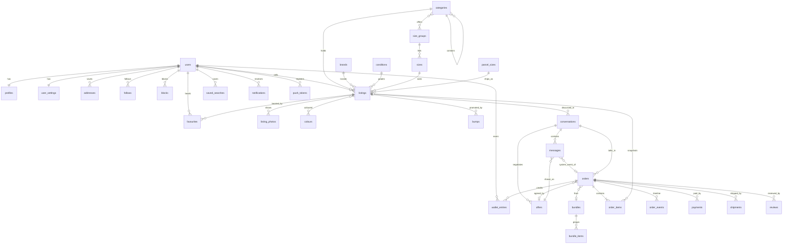
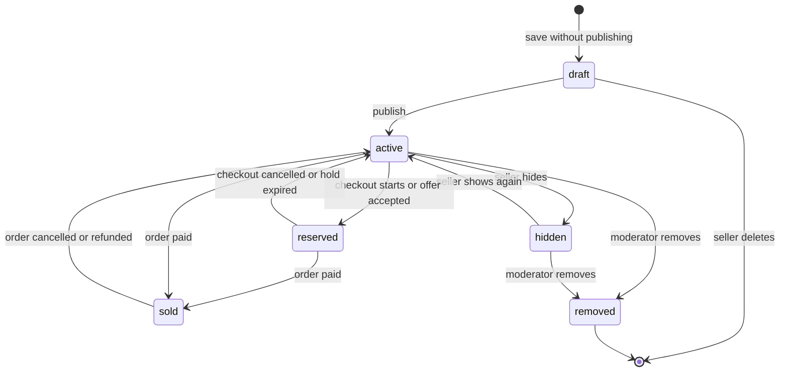
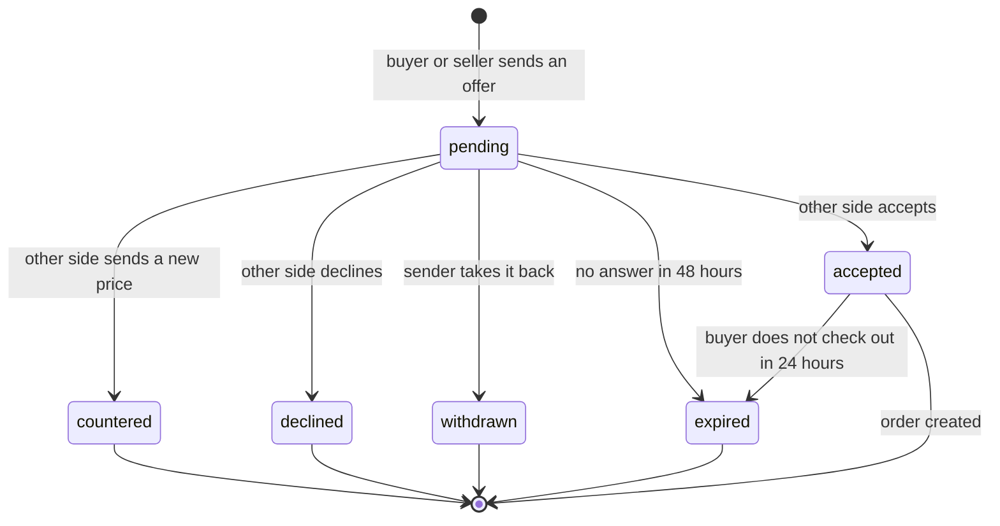
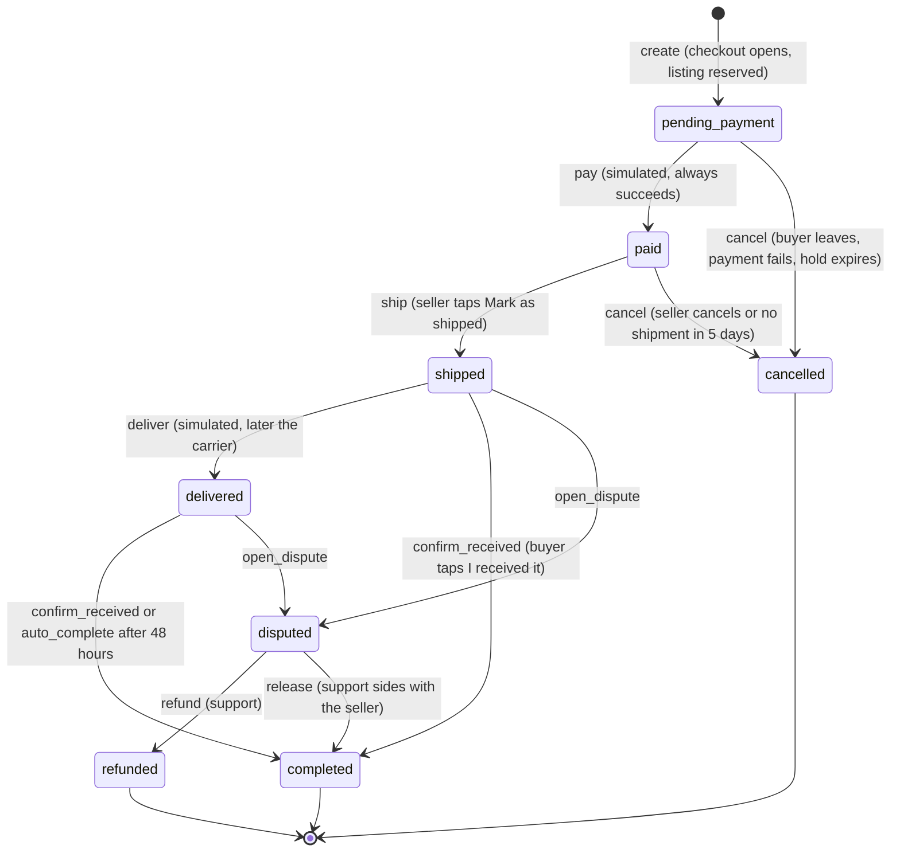

# Data model

This is the single description of everything the database stores. It is written for people, so every table has a plain purpose line, the fields, the rules that keep the data honest, and the screens that use it. The Drizzle schema in `packages/db/src/schema/` is the code version of this page. **If you change the schema, change this page in the same commit.**

Version 1 covers everything in the Vinted app spec except real payments and real shipping. Checkout is simulated, but the order model is built so real payment and shipping can replace only the "pay", "ship" and "deliver" steps later.

## How to read this page

- **Ids** are random UUIDs made by Postgres. Reference tables also have a `slug`, a stable readable name that seed files and the app use.
- **Money** is always an integer in minor units (agorot for shekels) next to an ISO currency code. 12.50 shekels is `1250` with `ILS`. Nothing stores decimals, so rounding never drifts.
- **Times** are `timestamptz` (a moment in time with its time zone). The server stores UTC.
- **Two languages.** Reference data (categories, conditions, colours, materials, sizes, parcel sizes, badges) has `name_en` and `name_he` columns. User content (titles, descriptions, messages, bios) is stored exactly as written and is never translated in place. Notifications store a type and some values, and the app turns them into a sentence in the reader's language.
- **Photos** are never stored in the database. The database keeps an object key (the file's name in S3 compatible storage, Cloudflare R2 in production) plus width and height. The app builds the URL from a base address and the key.
- **Delete rules.** Content that belongs to a person goes away with the person (cascade). Money records (orders, wallet entries) block deleting a user (restrict), because a closed account is anonymised instead, see `profiles.deleted_at`.
- **Status values** are Postgres enums. The same lists live in `packages/shared/src/enums.ts`, which is the single source for both the database and the zod schemas.

## Entity list

62 tables in 10 groups.

| Group | Tables |
|---|---|
| Accounts (Better Auth) | `users`, `sessions`, `accounts`, `verifications` |
| People | `profiles`, `user_settings`, `notification_preferences`, `addresses`, `follows`, `blocks`, `user_sizes`, `user_brands`, `push_tokens`, `badge_definitions`, `user_badges`, `referrals`, `vouchers` |
| Reference data | `currencies`, `categories`, `category_size_groups`, `size_groups`, `sizes`, `conditions`, `colours`, `materials`, `patterns`, `brands`, `brand_requests`, `parcel_sizes`, `fee_rules`, `bump_plans`, `platform_settings` |
| Listings | `listings`, `listing_photos`, `listing_colours`, `listing_price_history`, `favourites`, `listing_views`, `saved_searches`, `recent_searches`, `bundle_discount_tiers`, `bundles`, `bundle_items`, `bumps` |
| Messaging | `conversations`, `messages`, `offers` |
| Orders | `orders`, `order_items`, `order_events`, `payments`, `shipments` |
| Reviews | `reviews` |
| Money | `wallet_entries` |
| Engagement and safety | `notifications`, `reports` |
| Recommendations (Milestone 7) | `user_events`, `user_affinities`, `feed_hidden`, `feed_snapshots`, view `listing_popularity_7d` |
| Admin panel | `ai_calls`, `admin_actions`, `kill_switches`, `expense_config`, `expense_months`, `expense_items`, `stand_in_sellers`, `admin_uploads` |

## Overview diagram

Only the main relations are drawn. Every table is described below.



## Accounts (Better Auth)

Better Auth is added in Milestone 1. These four tables match Better Auth 1.7 exactly (checked against the library's own schema), so Milestone 1 needs no refactor. Table names are plural, so the auth config needs `usePlural: true`, and ids are database UUIDs, so it needs `advanced.database.generateId: "uuid"`. The Drizzle adapter then maps `user`, `session`, `account` and `verification` onto these tables.

Our own profile data is **not** put on the auth user. Better Auth's guidance is to keep the auth table small and extend it only with plugin fields, so people-facing data lives in `profiles` and `user_settings`. The only extra columns on `users` come from two Better Auth plugins: `username` and `display_username` (username plugin) and `role`, `banned`, `ban_reason`, `ban_expires` (admin plugin). `sessions.impersonated_by` is the admin plugin's column too.


### `users`

One row per person who can sign in. Created by Better Auth when someone signs up with Google, Apple or email and password.

Used by: every screen that shows a person, sign in and onboarding, Settings (Profile details, Account settings).

| Field | Type | Null | Notes |
|---|---|---|---|
| `id` | uuid | no | primary key. default gen_random_uuid() |
| `name` | text | no |  |
| `email` | text | no | Unique |
| `email_verified` | boolean | no | default false |
| `image` | text | yes | Photo URL from Google or Apple when they give one |
| `created_at` | timestamptz | no | default now() |
| `updated_at` | timestamptz | no | default now() |
| `username` | text | yes | Unique, lower case. Picked during onboarding. Null until then |
| `display_username` | text | yes | The same name with the capitals the person typed |
| `role` | user_role | no | default 'user'. user, moderator or admin. Admin plugin |
| `banned` | boolean | no | default false. Admin plugin. A banned person cannot sign in |
| `ban_reason` | text | yes |  |
| `ban_expires` | timestamptz | yes |  |

Constraints:

- Unique: (email)
- Unique: (username)

Indexes:

- `users_username_prefix_idx`: btree on (lower(username) text_pattern_ops)

A username must be unique and is searched by prefix on the Members tab, which is what `users_username_prefix_idx` is for.

### `sessions`

A signed in device. Better Auth creates one per sign in and the app keeps the token in secure storage.

Used by: Settings (Security), every signed in request.

| Field | Type | Null | Notes |
|---|---|---|---|
| `id` | uuid | no | primary key. default gen_random_uuid() |
| `expires_at` | timestamptz | no |  |
| `token` | text | no | Unique session token |
| `created_at` | timestamptz | no | default now() |
| `updated_at` | timestamptz | no | default now() |
| `ip_address` | text | yes |  |
| `user_agent` | text | yes |  |
| `user_id` | uuid | no | refers to users.id, on delete cascade |
| `impersonated_by` | text | yes |  |

Constraints:

- Unique: (token)

Indexes:

- `sessions_user_id_idx`: btree on (user_id)

### `accounts`

One sign in method linked to a user. A person with Google and a password has two rows.

Used by: Settings (Security), the Verified info rows on a profile (Google, Email).

| Field | Type | Null | Notes |
|---|---|---|---|
| `id` | uuid | no | primary key. default gen_random_uuid() |
| `account_id` | text | no | The provider's own id. For credential it is the user id |
| `provider_id` | text | no | google, apple or credential |
| `user_id` | uuid | no | refers to users.id, on delete cascade |
| `access_token` | text | yes |  |
| `refresh_token` | text | yes |  |
| `id_token` | text | yes |  |
| `access_token_expires_at` | timestamptz | yes |  |
| `refresh_token_expires_at` | timestamptz | yes |  |
| `scope` | text | yes |  |
| `password` | text | yes | Hashed by Better Auth, only for credential accounts |
| `created_at` | timestamptz | no | default now() |
| `updated_at` | timestamptz | no | default now() |

Indexes:

- `accounts_provider_idx`: btree on (provider_id, account_id)
- `accounts_user_id_idx`: btree on (user_id)

### `verifications`

Short lived tokens for email verification and password reset. In version 1 these hold the hashed 6 digit codes sent by email (identifier like `forget-password-otp-<email>`).

Used by: Sign in, Settings (Account settings).

| Field | Type | Null | Notes |
|---|---|---|---|
| `id` | uuid | no | primary key. default gen_random_uuid() |
| `identifier` | text | no | What is being verified, such as an email address |
| `value` | text | no |  |
| `expires_at` | timestamptz | no |  |
| `created_at` | timestamptz | no | default now() |
| `updated_at` | timestamptz | no | default now() |

Indexes:

- `verifications_identifier_idx`: btree on (identifier)
## People

Everything about a person other than how they sign in.

### `profiles`

The public face of a user, one row each, created together with the user. It also holds the running counters (followers, reviews) so a profile page needs a single read.

Used by: Profile (own and other members), item page seller row, member search, Inbox rows, review rows.

| Field | Type | Null | Notes |
|---|---|---|---|
| `user_id` | uuid | no | primary key. refers to users.id, on delete cascade |
| `bio` | text | yes |  |
| `avatar_key` | text | yes | Object key of the avatar photo |
| `country_code` | char(2) | no | default 'IL'. ISO country, IL by default |
| `city` | text | yes |  |
| `last_seen_at` | timestamptz | yes | Shown as Last seen on the About tab, hidden when the user turns it off in settings |
| `follower_count` | integer | no | default 0 |
| `following_count` | integer | no | default 0 |
| `active_listing_count` | integer | no | default 0 |
| `sold_count` | integer | no | default 0 |
| `member_review_count` | integer | no | default 0. Reviews written by members. Their average is member_rating_sum divided by this |
| `member_rating_sum` | integer | no | default 0 |
| `automatic_review_count` | integer | no | default 0. Automatic reviews are scored apart, as in the spec (Member reviews and Automatic reviews rows) |
| `automatic_rating_sum` | integer | no | default 0 |
| `holiday_mode_enabled` | boolean | no | default false. While true the seller's listings are left out of the feed and search. The listings themselves keep status active |
| `holiday_started_at` | timestamptz | yes |  |
| `holiday_ends_at` | timestamptz | yes |  |
| `invite_code` | text | yes | Unique code for the Invite a friend page |
| `deleted_at` | timestamptz | yes | Set when the account is closed. The row is kept and the personal fields are cleared, so orders and reviews keep their history |
| `created_at` | timestamptz | no | default now() |
| `updated_at` | timestamptz | no | default now() |

Constraints:

- Check `profiles_counts_nonneg`: ((follower_count >= 0) AND (following_count >= 0) AND (active_listing_count >= 0) AND (sold_count >= 0))
- Unique: (invite_code)

Indexes:

- `profiles_holiday_idx`: btree on (holiday_mode_enabled), only where holiday_mode_enabled

Counters are updated by the server in the same transaction as the change that moves them (a follow, a review, a sale). A nightly job can recompute them from the source tables if they ever drift.

### `user_settings`

Settings that are not part of the public profile. One row each.

Used by: Settings (Language, Push notifications, Postage, Privacy), feed personalisation, checkout currency.

| Field | Type | Null | Notes |
|---|---|---|---|
| `user_id` | uuid | no | primary key. refers to users.id, on delete cascade |
| `language` | locale | no | default 'he'. The app language, en or he. This is the single source of truth for the user's language |
| `currency` | char(3) | no | refers to currencies.code, on delete no action. default 'ILS' |
| `push_enabled` | boolean | no | default true |
| `push_daily_limit` | smallint | yes | Null means no daily limit. The spec offers Up to N notifications per day |
| `email_enabled` | boolean | no | default true |
| `personalise_feed` | boolean | no | default true. Lets the feed use favourites, sizes and brands (Settings, Privacy) |
| `shops_for` | text[] | no | default '{}'. What the person shops for: women, men, kids (the sign up question and Shopping preferences). Never fades. Empty means not answered, then Home works the groups out from behaviour (`docs/plans/home-feed.md` section 11) |
| `show_last_seen` | boolean | no | default true |
| `ship_from_home` | boolean | no | default false. Seller option: a courier collects from the address |
| `ship_from_dropoff` | boolean | no | default true. Seller option: take the parcel to a locker or shop |
| `updated_at` | timestamptz | no | default now() |

Face ID or Touch ID unlock is a device feature. Whether it is switched on is kept on the phone in secure storage, so there is no column for it.

### `notification_preferences`

Per type and per channel switches. Only rows the user changed exist. A missing row means the default, which is defined in code when notifications are built (Milestone 6).

Used by: Settings (Push notifications, Email notifications).

| Field | Type | Null | Notes |
|---|---|---|---|
| `user_id` | uuid | no | refers to users.id, on delete cascade |
| `type` | notification_type | no | The notification type, for example listing_favourited |
| `channel` | notification_channel | no | push or email |
| `enabled` | boolean | no |  |
| `updated_at` | timestamptz | no | default now() |

Composite primary key: (user_id, type, channel).

Indexes:

- `notification_preferences_user_id_type_channel_pk` (unique): btree on (user_id, type, channel)

### `addresses`

A saved postal address. The default one is used at checkout and as the seller's collection address.

Used by: Checkout (Address card), Settings (Postage, Your address).

| Field | Type | Null | Notes |
|---|---|---|---|
| `id` | uuid | no | primary key. default gen_random_uuid() |
| `user_id` | uuid | no | refers to users.id, on delete cascade |
| `label` | text | yes |  |
| `full_name` | text | no |  |
| `line1` | text | no |  |
| `line2` | text | yes |  |
| `city` | text | no |  |
| `postcode` | text | no |  |
| `country_code` | char(2) | no | default 'IL' |
| `phone` | text | yes |  |
| `is_default` | boolean | no | default false. At most one default per user, enforced by a partial unique index |
| `created_at` | timestamptz | no | default now() |
| `updated_at` | timestamptz | no | default now() |

Indexes:

- `addresses_one_default_per_user` (unique): btree on (user_id), only where is_default
- `addresses_user_idx`: btree on (user_id)

### `follows`

One member following another.

Used by: Profile (Follow button, follower and following counts), notifications for new items from followed sellers.

| Field | Type | Null | Notes |
|---|---|---|---|
| `follower_id` | uuid | no | refers to users.id, on delete cascade |
| `followee_id` | uuid | no | refers to users.id, on delete cascade |
| `created_at` | timestamptz | no | default now() |

Composite primary key: (follower_id, followee_id).

Constraints:

- Check `follows_not_self`: (follower_id <> followee_id)

Indexes:

- `follows_followee_idx`: btree on (followee_id, created_at DESC NULLS LAST)
- `follows_follower_id_followee_id_pk` (unique): btree on (follower_id, followee_id)

The follower count on `profiles` is kept in step by the server.

### `blocks`

A member blocking another. A blocked person cannot message, offer or buy, and their listings are left out of the blocker's feed.

Used by: Profile (the ... menu), conversation info.

| Field | Type | Null | Notes |
|---|---|---|---|
| `blocker_id` | uuid | no | refers to users.id, on delete cascade |
| `blocked_id` | uuid | no | refers to users.id, on delete cascade |
| `created_at` | timestamptz | no | default now() |

Composite primary key: (blocker_id, blocked_id).

Constraints:

- Check `blocks_not_self`: (blocker_id <> blocked_id)

Indexes:

- `blocks_blocked_idx`: btree on (blocked_id)
- `blocks_blocker_id_blocked_id_pk` (unique): btree on (blocker_id, blocked_id)

Blocking is one direction in storage. The server checks both directions when it decides who may message whom.

### `user_sizes`

Personalisation: sizes the member shops for.

Used by: Personalisation (Preferred sizes), feed ranking.

| Field | Type | Null | Notes |
|---|---|---|---|
| `user_id` | uuid | no | refers to users.id, on delete cascade |
| `size_id` | uuid | no | refers to sizes.id, on delete cascade |

Composite primary key: (user_id, size_id).

Indexes:

- `user_sizes_user_id_size_id_pk` (unique): btree on (user_id, size_id)

Which sizes a member picked is also the default for the Size filter.

### `user_brands`

Personalisation: brands the member follows.

Used by: Personalisation (Brands, Follow button), feed ranking, new item alerts from brands.

| Field | Type | Null | Notes |
|---|---|---|---|
| `user_id` | uuid | no | refers to users.id, on delete cascade |
| `brand_id` | uuid | no | refers to brands.id, on delete cascade |
| `created_at` | timestamptz | no | default now() |

Composite primary key: (user_id, brand_id).

Indexes:

- `user_brands_brand_idx`: btree on (brand_id)
- `user_brands_user_id_brand_id_pk` (unique): btree on (user_id, brand_id)

### `push_tokens`

A phone that can receive push notifications. One person may have several.

Used by: Push notifications, sign out (revokes the token).

| Field | Type | Null | Notes |
|---|---|---|---|
| `id` | uuid | no | primary key. default gen_random_uuid() |
| `user_id` | uuid | no | refers to users.id, on delete cascade |
| `token` | text | no | The Expo or platform push token. Unique |
| `platform` | push_platform | no |  |
| `device_id` | text | yes |  |
| `locale` | locale | yes |  |
| `last_seen_at` | timestamptz | no | default now() |
| `revoked_at` | timestamptz | yes | Set on sign out or when the push service says the token is dead |
| `created_at` | timestamptz | no | default now() |

Constraints:

- Unique: (token)

Indexes:

- `push_tokens_user_idx`: btree on (user_id), only where revoked_at IS NULL

### `badge_definitions`

The list of badges a member can earn. Reference data, bilingual.

Used by: Profile tab (Badges you earned), seller profile trust pills such as Frequent uploads and Speedy shipping.

| Field | Type | Null | Notes |
|---|---|---|---|
| `id` | uuid | no | primary key. default gen_random_uuid() |
| `slug` | text | no |  |
| `name_en` | text | no |  |
| `name_he` | text | no |  |
| `description_en` | text | no |  |
| `description_he` | text | no |  |
| `icon` | text | no | Lucide icon name |
| `target` | integer | no | default 1. Progress needed to earn it |
| `show_on_profile` | boolean | no | default false. True for trust pills that buyers should see |

Constraints:

- Unique: (slug)

### `user_badges`

A member's progress toward each badge and the moment they earned it.

Used by: Profile tab (the N of N progress bar).

| Field | Type | Null | Notes |
|---|---|---|---|
| `user_id` | uuid | no | refers to users.id, on delete cascade |
| `badge_id` | uuid | no | refers to badge_definitions.id, on delete cascade |
| `progress` | integer | no | default 0 |
| `earned_at` | timestamptz | yes | Null while the badge is still in progress |

Composite primary key: (user_id, badge_id).

Indexes:

- `user_badges_badge_idx`: btree on (badge_id)
- `user_badges_user_id_badge_id_pk` (unique): btree on (user_id, badge_id)

### `referrals`

Invite a friend. One row per invited person. When the friend completes their first order, both sides receive a voucher.

Used by: Invite friends, Your referrals.

| Field | Type | Null | Notes |
|---|---|---|---|
| `id` | uuid | no | primary key. default gen_random_uuid() |
| `inviter_id` | uuid | no | refers to users.id, on delete cascade |
| `invitee_id` | uuid | no | refers to users.id, on delete cascade |
| `status` | referral_status | no | default 'pending'. pending, qualified, rewarded or void |
| `qualified_at` | timestamptz | yes |  |
| `rewarded_at` | timestamptz | yes |  |
| `created_at` | timestamptz | no | default now() |

Constraints:

- Unique: (invitee_id)
- Check `referrals_not_self`: (inviter_id <> invitee_id)

Indexes:

- `referrals_inviter_idx`: btree on (inviter_id, created_at DESC NULLS LAST)

Referral states: `pending` (signed up with a code), `qualified` (first order completed), `rewarded` (both vouchers issued), `void` (abuse check failed).

### `vouchers`

Credit given to a member, for example the Get 15, give 15 reward. Applied automatically at checkout when the order is big enough.

Used by: Invite friends, Checkout (Total to pay), Profile tab.

| Field | Type | Null | Notes |
|---|---|---|---|
| `id` | uuid | no | primary key. default gen_random_uuid() |
| `user_id` | uuid | no | refers to users.id, on delete cascade |
| `source` | text | no | default 'referral' |
| `amount_minor` | integer | no | Amount in minor units |
| `currency` | char(3) | no | refers to currencies.code, on delete no action. default 'ILS' |
| `min_order_minor` | integer | no | default 0. The items total must reach this for the voucher to apply |
| `status` | voucher_status | no | default 'active'. active, used or expired |
| `expires_at` | timestamptz | yes |  |
| `created_at` | timestamptz | no | default now() |

Constraints:

- Check `vouchers_amount_positive`: (amount_minor > 0)

Indexes:

- `vouchers_user_idx`: btree on (user_id, status)

In version 1 vouchers are stored and shown but never deducted, because nothing is charged. `orders.voucher_id` and `orders.voucher_discount_minor` are ready for it.

## Reference data

Rarely changing lists that the sell form and the filters read. All of them are seeded from typed files in `packages/db/src/seed/reference/` and are served to the app in one cacheable response (`GET /v1/reference`). Seeding is an upsert by `slug`, so it is safe to run again, including in production.

### `currencies`

The currencies the platform knows. `is_enabled` decides which ones sellers can price in. In version 1 only ILS is enabled.

Used by: Sell form (Price), every price on screen, Settings.

| Field | Type | Null | Notes |
|---|---|---|---|
| `code` | char(3) | no | primary key. ISO 4217 code, the primary key |
| `symbol` | text | no |  |
| `minor_unit_exponent` | smallint | no | default 2. 2 for shekels, 0 for yen |
| `name_en` | text | no |  |
| `name_he` | text | no |  |
| `is_enabled` | boolean | no | default true |

Whether the product is single market (ILS only) or multi currency is an open decision, see the end of this page.

### `categories`

The category tree, 4 levels deep: for example Women, Clothing, Dresses, Midi dresses. A listing always belongs to a leaf.

Used by: Browse tiles, category picker, Catalog page, Filter (Category), Sell form, search.

| Field | Type | Null | Notes |
|---|---|---|---|
| `id` | uuid | no | primary key. default gen_random_uuid() |
| `parent_id` | uuid | yes | refers to categories.id, on delete restrict |
| `slug` | text | no | Full slug, such as women-clothing-dresses-midi. Unique |
| `path` | text | no | The slugs from the root joined with a slash, such as women/clothing/dresses/midi. A prefix match finds a whole subtree without a recursive query |
| `depth` | smallint | no | default 0 |
| `name_en` | text | no |  |
| `name_he` | text | no |  |
| `icon` | text | yes | Lucide icon name. A node without its own icon uses its parent's |
| `sort_order` | smallint | no | default 0 |
| `is_leaf` | boolean | no | default false |
| `is_active` | boolean | no | default true |
| `brand_mode` | attribute_mode | no | default 'optional'. required, optional or hidden. Decides whether the sell form shows a Brand row for this category |
| `size_mode` | attribute_mode | no | default 'hidden'. The same for the Size row. Which sizes appear is decided by category_size_groups |
| `condition_mode` | attribute_mode | no | default 'required'. Same idea |
| `colour_mode` | attribute_mode | no | default 'optional'. Same idea |
| `material_mode` | attribute_mode | no | default 'hidden'. Same idea |
| `pattern_mode` | attribute_mode | no | default 'hidden'. Pattern shows for clothing |
| `default_parcel_size_id` | uuid | yes | refers to parcel_sizes.id, on delete set null. The recommended parcel size, pre-selected in the sell form |
| `created_at` | timestamptz | no | default now() |
| `updated_at` | timestamptz | no | default now() |

Constraints:

- Unique: (path)
- Unique: (slug)

Indexes:

- `categories_parent_idx`: btree on (parent_id, sort_order)
- `categories_path_prefix_idx`: btree on (path text_pattern_ops)

How the attribute rules work: each category row carries the rules that apply to it. The seed file sets a rule on a branch and every child inherits it unless it sets its own. So Women, Clothing says size required, material optional, pattern optional, and Women, Bags turns size off. The sell form reads these rules to decide which rows to reveal after a category is picked, which matches the spec (the form grows as you choose a category).

To list a category with everything under it: `category_id IN (SELECT id FROM categories WHERE path LIKE 'women/clothing/%')`. The `text_pattern_ops` index makes that prefix match use an index.

The clothing tree (D-033). A category says what the garment is, not its fabric, occasion or fit, so Linen, Denim, Casual and Formal are not categories (Material is a filter). The purpose groups Sportswear, Maternity and Uniforms and costumes stay because people shop them as a group. Women and Men have the same names where the garment is the same. Slugs are the parent slugs joined with a dash, for example `women-clothing-tops-button-up`. The tree below is the clothing part, the rest of the tree (shoes, bags, home and so on) did not change.

- **Women, Clothing**
  - Dresses: Mini dresses, Midi dresses, Maxi dresses, Shirt dresses, Wrap dresses, Slip dresses, Cocktail dresses, Gowns, Wedding dresses, Other dresses
  - Tops: T-shirts, Button-up shirts, Blouses, Tank tops and camis, Crop tops, Long sleeve tops, Bodysuits, Corsets and bustiers, Tunics, Overshirts
  - Sweatshirts and hoodies: Hoodies, Sweatshirts, Zip hoodies
  - Knitwear: Jumpers, Cardigans, Roll necks, Knit vests
  - Jeans: Skinny jeans, Straight jeans, Wide leg jeans, Flared jeans, Relaxed and mom jeans
  - Trousers: Tailored trousers, Wide leg trousers, Cargo trousers, Leggings, Joggers and sweatpants, Culottes
  - Shorts
  - Skirts: Mini skirts, Midi skirts, Maxi skirts, Pencil skirts, Pleated skirts
  - Coats: Wool coats, Trench coats, Parkas, Puffer coats, Raincoats, Capes and ponchos
  - Jackets: Denim jackets, Leather and biker jackets, Bomber jackets, Windbreakers, Utility and work jackets, Fleece jackets, Other jackets
  - Blazers
  - Vests and gilets
  - Jumpsuits: Jumpsuits, Playsuits
  - Dungarees
  - Matching sets: Two-piece sets, Suits
  - Kimonos and kaftans
  - Swimwear: Bikinis, One piece swimsuits, Tankinis, Swim shorts, Cover ups and sarongs
  - Surfwear: Wetsuits, Rash guards and swim tops, Board shorts, Surf ponchos and changing robes
  - Underwear and sleepwear: Bras, Knickers, Shapewear, Tights and socks, Pyjamas, Nightdresses, Robes
  - Sportswear: Sports bras, Sports tops, Sports leggings, Sports shorts, Track jackets, Tracksuits, Team shirts, Running clothes, Cycling clothes, Gym and training clothes, Yoga and pilates clothes, Tennis and padel clothes, Ski and snowboard clothes, Hiking and outdoor clothes
  - Maternity
  - Uniforms and costumes: Military and surplus, Work uniforms, Costumes
- **Men, Clothing**
  - Tops: T-shirts, Polo shirts, Long sleeve tops, Tank tops
  - Shirts: Button-up shirts, Short sleeve button-ups, Collarless shirts, Overshirts
  - Sweatshirts and hoodies: Hoodies, Sweatshirts, Zip hoodies
  - Knitwear: Jumpers, Cardigans, Roll necks, Knit vests
  - Jeans: Slim jeans, Straight jeans, Relaxed and baggy jeans, Flared jeans
  - Trousers: Chinos, Tailored trousers, Cargo trousers, Joggers and sweatpants, Work trousers
  - Shorts
  - Suits: Suits, Tuxedos, Blazers, Waistcoats
  - Coats: Wool coats, Trench coats, Parkas, Puffer coats, Raincoats
  - Jackets: Denim jackets, Leather and biker jackets, Bomber jackets, Windbreakers, Utility and work jackets, Varsity jackets, Fleece jackets, Other jackets
  - Vests and gilets
  - Jumpsuits: Jumpsuits, Boiler suits
  - Dungarees
  - Swimwear: Swim shorts, Swim briefs
  - Surfwear: Wetsuits, Rash guards and swim tops, Board shorts, Surf ponchos and changing robes
  - Underwear and sleepwear: Underwear, Socks, Pyjamas, Robes
  - Sportswear: Sports tops, Sports shorts, Sports trousers, Track jackets, Tracksuits, Team shirts, Running clothes, Cycling clothes, Gym and training clothes, Yoga and pilates clothes, Tennis and padel clothes, Ski and snowboard clothes, Hiking and outdoor clothes
  - Uniforms and costumes: Military and surplus, Work uniforms, Costumes
- **Kids, Girls**
  - Tops: T-shirts, Shirts, Polo shirts, Long sleeve tops
  - Sweatshirts and knitwear: Hoodies, Sweatshirts, Jumpers, Cardigans
  - Dresses
  - Skirts
  - Trousers: Jeans, Trousers, Leggings, Joggers
  - Shorts
  - Dungarees
  - Jumpsuits
  - Coats and jackets: Coats, Puffer jackets, Raincoats, Denim and light jackets
  - Swimwear
  - Pyjamas
  - Underwear and socks
  - Sportswear and team kit
  - Costumes and uniforms
- **Kids, Boys**
  - Tops: T-shirts, Shirts, Polo shirts, Long sleeve tops
  - Sweatshirts and knitwear: Hoodies, Sweatshirts, Jumpers, Cardigans
  - Trousers: Jeans, Trousers, Leggings, Joggers
  - Shorts
  - Dungarees
  - Jumpsuits
  - Coats and jackets: Coats, Puffer jackets, Raincoats, Denim and light jackets
  - Swimwear
  - Pyjamas
  - Underwear and socks
  - Sportswear and team kit
  - Costumes and uniforms
- **Kids, Baby**
  - Bodysuits
  - Rompers and dungarees
  - Sleepsuits and pyjamas
  - Tops
  - Trousers and leggings
  - Dresses and skirts
  - Knitwear
  - Coats and snowsuits
  - Sets and outfits
  - Hats, mittens and booties

Moving from the old tree: `packages/db/src/seed/reference/category-moves.ts` lists every old category and where it went. `pnpm db:seed:reference` runs `moveCategories` (in `packages/db/src/seed/category-moves.ts`) after the new categories are written: it moves listings to the new category (setting Material to Linen or Denim where the old category implied it and the listing had none), points saved searches, "not interested" rows and taste scores at the new categories, then deletes the old rows, only when nothing points at them. It is one transaction and does nothing on a second run or on a database that never had the old tree.

### `category_size_groups`

Which size groups a category offers. A category can offer more than one, for example letters and EU numbers for women's clothing.

Used by: Sell form (Size picker), Filter (Size).

| Field | Type | Null | Notes |
|---|---|---|---|
| `category_id` | uuid | no | refers to categories.id, on delete cascade |
| `size_group_id` | uuid | no | refers to size_groups.id, on delete cascade |
| `sort_order` | smallint | no | default 0. Order of the groups in the picker |

Composite primary key: (category_id, size_group_id).

Indexes:

- `category_size_groups_category_id_size_group_id_pk` (unique): btree on (category_id, size_group_id)
- `category_size_groups_group_idx`: btree on (size_group_id)

### `size_groups`

A family of sizes: clothing letters, women's EU numbers, women's and men's waist, women's, men's and kids' shoes, kids by age, belts, one size.

Used by: Size picker, Filter (Size), Personalisation.

| Field | Type | Null | Notes |
|---|---|---|---|
| `id` | uuid | no | primary key. default gen_random_uuid() |
| `slug` | text | no |  |
| `name_en` | text | no |  |
| `name_he` | text | no |  |
| `kind` | size_kind | no | letter, numeric, shoe, kids_age, waist or one_size |
| `sort_order` | smallint | no | default 0 |

Constraints:

- Unique: (slug)

### `sizes`

One size inside a group.

Used by: Size picker, listing cards (size and condition line), Filter (Size).

| Field | Type | Null | Notes |
|---|---|---|---|
| `id` | uuid | no | primary key. default gen_random_uuid() |
| `size_group_id` | uuid | no | refers to size_groups.id, on delete cascade |
| `slug` | text | no |  |
| `label` | text | no | What is printed on the tile, such as M, 42 or W32 |
| `name_en` | text | no |  |
| `name_he` | text | no | Spoken form for Hebrew, for example Waist 32 is shown with the Hebrew word for waist |
| `sort_order` | smallint | no | default 0 |

Constraints:

- Unique: (size_group_id, slug)

Indexes:

- `sizes_group_idx`: btree on (size_group_id, sort_order)

### `conditions`

The five conditions from the spec: New with tags, New without tags, Very good, Good, Satisfactory, each with a short description.

Used by: Sell form (Condition), Filter (Condition), item page meta line, cards.

| Field | Type | Null | Notes |
|---|---|---|---|
| `id` | uuid | no | primary key. default gen_random_uuid() |
| `slug` | text | no |  |
| `name_en` | text | no |  |
| `name_he` | text | no |  |
| `description_en` | text | no |  |
| `description_he` | text | no |  |
| `rank` | smallint | no | 1 is best |

Constraints:

- Unique: (slug)

### `colours`

Colour choices with a swatch for the filter.

Used by: Sell form (Colours, up to 2), Filter (Colour).

| Field | Type | Null | Notes |
|---|---|---|---|
| `id` | uuid | no | primary key. default gen_random_uuid() |
| `slug` | text | no |  |
| `name_en` | text | no |  |
| `name_he` | text | no |  |
| `swatch_hex` | text | no | The swatch colour. This is reference data, not a design token |
| `sort_order` | smallint | no | default 0 |

Constraints:

- Unique: (slug)

### `materials`

Material choices.

Used by: Sell form (Material), Filter (Material).

| Field | Type | Null | Notes |
|---|---|---|---|
| `id` | uuid | no | primary key. default gen_random_uuid() |
| `slug` | text | no |  |
| `name_en` | text | no |  |
| `name_he` | text | no |  |
| `sort_order` | smallint | no | default 0 |

Constraints:

- Unique: (slug)

### `patterns`

Pattern choices such as striped or floral. Only clothing categories show the Pattern row.

Used by: Sell form, Filter (Pattern).

| Field | Type | Null | Notes |
|---|---|---|---|
| `id` | uuid | no | primary key. default gen_random_uuid() |
| `slug` | text | no |  |
| `name_en` | text | no |  |
| `name_he` | text | no |  |
| `sort_order` | smallint | no | default 0 |

Constraints:

- Unique: (slug)

### `brands`

The brand list. Starts with about 160 common brands, can grow as members ask.

Used by: Sell form (Brand), Filter (Brand, with a search field), Personalisation (Follow), brand page.

| Field | Type | Null | Notes |
|---|---|---|---|
| `id` | uuid | no | primary key. default gen_random_uuid() |
| `slug` | text | no |  |
| `name` | text | no |  |
| `logo_key` | text | yes | Object key of a logo, not used in version 1 |
| `popularity` | integer | no | default 0. Higher shows first in pickers |
| `is_active` | boolean | no | default true |
| `created_at` | timestamptz | no | default now() |

Constraints:

- Unique: (slug)

Indexes:

- `brands_name_prefix_idx`: btree on (lower(name) text_pattern_ops)
- `brands_popularity_idx`: btree on (popularity DESC NULLS LAST, name)

A listing also copies the brand name into `listings.brand_name`, so cards and search never need a join. Members cannot add brands themselves. They send a request (`brand_requests`) and Eden extends the list (decided for Milestone 2, open decision 7).

### `brand_requests`

A seller asking for a brand that is not on the list. Written by the Request a brand link in the brand picker, read by Eden, who adds the brand to `brands` by hand.

Used by: Sell form (Brand picker, Request a brand).

| Field | Type | Null | Notes |
|---|---|---|---|
| `id` | uuid | no | primary key. default gen_random_uuid() |
| `user_id` | uuid | no | refers to users.id, on delete cascade. Who asked |
| `name` | text | no | The brand as the seller typed it |
| `created_at` | timestamptz | no | default now() |

Indexes:

- `brand_requests_created_idx`: btree on (created_at DESC NULLS LAST)

### `parcel_sizes`

Small, Medium, Large and Extra large parcels with a weight limit and a simulated postage price.

Used by: Sell form (Parcel size), item page (Postage from), Checkout (Delivery option price).

| Field | Type | Null | Notes |
|---|---|---|---|
| `id` | uuid | no | primary key. default gen_random_uuid() |
| `slug` | text | no |  |
| `name_en` | text | no |  |
| `name_he` | text | no |  |
| `description_en` | text | no |  |
| `description_he` | text | no |  |
| `max_weight_grams` | integer | no |  |
| `max_length_mm` | integer | no | Longest side in millimetres |
| `price_minor` | integer | no | Simulated postage. Real carrier prices replace this when shipping goes live |
| `currency` | char(3) | no | refers to currencies.code, on delete no action. default 'ILS' |
| `sort_order` | smallint | no | default 0 |
| `is_active` | boolean | no | default true |

Constraints:

- Check `parcel_sizes_price_nonneg`: (price_minor >= 0)
- Unique: (slug)

### `fee_rules`

The buyer protection fee as data. The spec's rule is about 5 percent plus a fixed part (0.70 euro), so 500 basis points plus a fixed amount.

Used by: Item page and cards (the price with the shield), Price breakdown sheet, Checkout.

| Field | Type | Null | Notes |
|---|---|---|---|
| `id` | uuid | no | primary key. default gen_random_uuid() |
| `currency` | char(3) | no | refers to currencies.code, on delete no action |
| `buyer_fee_basis_points` | integer | no | 100 basis points are 1 percent. 500 is 5 percent |
| `buyer_fee_fixed_minor` | integer | no | The fixed part in minor units. The ILS value is a placeholder, see the open decisions |
| `is_active` | boolean | no | default true |
| `active_from` | timestamptz | no | default now() |
| `created_at` | timestamptz | no | default now() |

Constraints:

- Check `fee_rules_bp_range`: ((buyer_fee_basis_points >= 0) AND (buyer_fee_basis_points <= 10000))
- Unique: (currency, active_from)
- Check `fee_rules_fixed_nonneg`: (buyer_fee_fixed_minor >= 0)

The fee is calculated by `calculateBuyerProtectionFee` in the shared package: round half up of (items total times basis points divided by 10000), plus the fixed part. In version 1 it is shown everywhere and charged nowhere. An order copies the numbers it used (`fee_basis_points`, `fee_fixed_minor`, `fee_rule_id`), so changing the rule later never rewrites old orders.

### `bump_plans`

What a bump costs and how long it lasts. Both plans are free in version 1, but the price column exists so a price can be added without a schema change.

Used by: Own profile (Bump button, Boost your visibility banner), Promotional tools.

| Field | Type | Null | Notes |
|---|---|---|---|
| `id` | uuid | no | primary key. default gen_random_uuid() |
| `slug` | text | no |  |
| `name_en` | text | no |  |
| `name_he` | text | no |  |
| `duration_hours` | integer | no |  |
| `price_minor` | integer | no | default 0. 0 in version 1 |
| `currency` | char(3) | no | refers to currencies.code, on delete no action. default 'ILS' |
| `is_active` | boolean | no | default true |

Constraints:

- Check `bump_plans_price_nonneg`: (price_minor >= 0)
- Unique: (slug)

### `platform_settings`

Tunable numbers kept as data, so they can change without a release: daily offer limit, offer expiry, how long a checkout holds an item, days to ship, and so on.

Used by: Server rules, the app reads a few (offer limit) from `GET /v1/reference`.

| Field | Type | Null | Notes |
|---|---|---|---|
| `key` | text | no | primary key. For example offer_daily_limit |
| `value` | jsonb | no | JSON value |
| `description` | text | yes |  |
| `updated_at` | timestamptz | no | default now() |

Seeded keys: `default_currency`, `offer_daily_limit` (15), `offer_expiry_hours` (48), `accepted_offer_hold_hours` (24), `checkout_hold_minutes` (30), `ship_by_days` (5), `auto_complete_hours_after_delivery` (48), `auto_review_rating` (5), `listing_max_photos` (20), `listing_min_price_minor`, `referral_reward_minor`, `referral_min_order_minor`, `bundle_min_items`, `single_market`.
## Listings

A listing is one item for sale. There is only ever one of each item, so there is no stock count.

### Listing states



| Status | Meaning | Visible in feed and search | Buyer can act |
|---|---|---|---|
| `draft` | Saved from the "Save changes before closing?" dialog or an unfinished form | No, only to the seller | No |
| `active` | For sale | Yes | Buy now, offer, message |
| `reserved` | Held for one buyer, either while an order waits for payment or after an accepted offer. `reserved_for_user_id` and `reserved_until` say who and until when | Yes, with a Reserved badge | Only the reserved buyer can buy |
| `sold` | A paid order exists | Not in the feed. Still reachable from Favourites and the seller's Sold chip, shown with the green Sold band | No |
| `hidden` | The seller paused it, or holiday mode is on | No | No |
| `removed` | A moderator took it down. `status_reason` says why | No | No |

The database also refuses a non-draft, non-removed listing that has no price or no category (`listings_published_has_price`).

### `listings`

The item for sale: title, description, what it is (category, brand, size, condition, colours, material), price and where it ships from.

Used by: Home feed, Search, Catalog, Brand page, Item page, Favourites, Sell form, Own profile (Active and Sold chips, views, favourites), Bump.

| Field | Type | Null | Notes |
|---|---|---|---|
| `id` | uuid | no | primary key. default gen_random_uuid() |
| `seller_id` | uuid | no | refers to users.id, on delete cascade |
| `status` | listing_status | no | default 'draft'. See the states above |
| `status_reason` | text | yes | Plain text for moderators |
| `title` | text | no |  |
| `description` | text | no | default '' |
| `category_id` | uuid | yes | refers to categories.id, on delete restrict |
| `brand_id` | uuid | yes | refers to brands.id, on delete set null |
| `brand_name` | text | yes | Copy of the brand name for cards and search |
| `size_id` | uuid | yes | refers to sizes.id, on delete set null |
| `condition_id` | uuid | yes | refers to conditions.id, on delete restrict |
| `material_id` | uuid | yes | refers to materials.id, on delete set null |
| `pattern_id` | uuid | yes | refers to patterns.id, on delete set null |
| `parcel_size_id` | uuid | yes | refers to parcel_sizes.id, on delete set null |
| `price_minor` | integer | yes | Item price in minor units. The buyer fee is added at display time and is not stored |
| `currency` | char(3) | no | refers to currencies.code, on delete no action. default 'ILS' |
| `previous_price_minor` | integer | yes | Set only when the price went down. Drives the Price drop badge and the struck-through Was line |
| `styles` | listing_style[] | no | default empty. Up to 3 style tags (D-042) from the fixed list `LISTING_STYLES` in `packages/shared/src/enums.ts`: vintage, y2k, streetwear, minimal, classic, quiet_luxury, boho, cottagecore, romantic, sporty, outdoor, preppy, grunge, goth, western, evening, workwear, summer, modest, basics. Set by the AI listing check, most fitting first. Behind the scenes only: never in any API answer, only the Home feed reads it |
| `styles_tagged_at` | timestamptz | yes | When the styles were last read by the AI. Null means never tagged, the nightly catch-up tags those |
| `used_ai_photos` | boolean | no | default false. The AI photo disclosure checkbox on the sell form |
| `country_code` | char(2) | no | default 'IL' |
| `city` | text | yes |  |
| `view_count` | integer | no | default 0. Incremented by the server, deduplicated per viewer per day |
| `favourite_count` | integer | no | default 0. Updated together with the favourites table |
| `bumped_at` | timestamptz | no | default now(). Feed order. Equals published_at until the listing is bumped or relisted |
| `bumped_until` | timestamptz | yes | While in the future the card shows the Buzzing badge. The end step sets it back to empty once it has passed (the history stays in `bumps`) |
| `published_at` | timestamptz | yes |  |
| `sold_at` | timestamptz | yes |  |
| `reserved_for_user_id` | uuid | yes | refers to users.id, on delete set null. Only set while status is reserved |
| `reserved_until` | timestamptz | yes |  |
| `search_vector` | tsvector | yes | generated, read only. tsvector built from title and brand (weight A) and description (weight B), using the simple text search configuration so it works for Hebrew and English |
| `created_at` | timestamptz | no | default now() |
| `updated_at` | timestamptz | no | default now() |

Constraints:

- Check `listings_counts_nonneg`: ((view_count >= 0) AND (favourite_count >= 0))
- Check `listings_price_nonneg`: ((price_minor IS NULL) OR (price_minor >= 0))
- Check `listings_published_has_price`: ((status = ANY (ARRAY['draft'::listing_status, 'removed'::listing_status]) OR (price_minor IS NOT NULL) AND (category_id IS NOT NULL))

Indexes:

- `listings_brand_idx`: btree on (brand_id, bumped_at DESC NULLS LAST), only where status = 'active'
- `listings_category_feed_idx`: btree on (category_id, bumped_at DESC NULLS LAST, id DESC NULLS LAST), only where status = 'active'
- `listings_condition_idx`: btree on (condition_id), only where status = 'active'
- `listings_feed_idx`: btree on (bumped_at DESC NULLS LAST, id DESC NULLS LAST), only where status = 'active'
- `listings_material_idx`: btree on (material_id), only where status = 'active'
- `listings_price_idx`: btree on (price_minor, id), only where status = 'active'
- `listings_reserved_idx`: btree on (reserved_until), only where status = 'reserved'
- `listings_search_idx`: gin on (search_vector), only where status = 'active'
- `listings_seller_idx`: btree on (seller_id, status, created_at DESC NULLS LAST)
- `listings_size_idx`: btree on (size_id, bumped_at DESC NULLS LAST), only where status = 'active'

Why `simple`: Postgres has no Hebrew dictionary. The simple configuration lowercases and splits words without stemming, which works for Hebrew and English. Prefix search (`word:*`) covers Hebrew prefixes written as separate letters poorly, for example a word starting with the letter for "the" or "in". That is an open decision (see the end).

Feed and filter queries are served by partial indexes that only contain active listings: feed order, category and feed order, price, brand, size, condition and material. Full text search uses a partial GIN index. Cursor pagination uses `(bumped_at, id)` as the cursor.

### `listing_photos`

The photos of a listing in order. Position 0 is the cover (the Main tag in the sell form).

Used by: Item page (swipeable photo), photo viewer, every card, Sell form (photo tiles).

| Field | Type | Null | Notes |
|---|---|---|---|
| `id` | uuid | no | primary key. default gen_random_uuid() |
| `listing_id` | uuid | no | refers to listings.id, on delete cascade |
| `object_key` | text | no | File name in object storage. Unique |
| `width` | integer | no |  |
| `height` | integer | no |  |
| `content_type` | text | no | default 'image/jpeg' |
| `byte_size` | integer | yes |  |
| `card_object_key` | text | yes | Small copy (about 480 px wide, WebP) that cards and lists load instead of the full photo. Null until made, the daily photo job fills old rows. Equal to `object_key` when the file could not be resized |
| `placeholder` | text | yes | Tiny blurred preview (a blurhash string) shown while the photo loads |
| `position` | smallint | no | default 0. 0 is the cover |
| `created_at` | timestamptz | no | default now() |

Constraints:

- Unique: (object_key)
- Check `listing_photos_size_positive`: ((width > 0) AND (height > 0))

Indexes:

- `listing_photos_listing_idx`: btree on (listing_id, "position")

### `listing_colours`

Up to two colours per listing.

Used by: Sell form (Colours), Filter (Colour).

| Field | Type | Null | Notes |
|---|---|---|---|
| `listing_id` | uuid | no | refers to listings.id, on delete cascade |
| `colour_id` | uuid | no | refers to colours.id, on delete restrict |
| `position` | smallint | no | default 0 |

Composite primary key: (listing_id, colour_id).

Indexes:

- `listing_colours_colour_idx`: btree on (colour_id, listing_id)
- `listing_colours_listing_id_colour_id_pk` (unique): btree on (listing_id, colour_id)

### `listing_price_history`

Each time a seller lowers a price, one row. Used to alert people who favourited the item and to show the Price drop badge.

Used by: Cards (Price drop), notifications (Reduced items).

| Field | Type | Null | Notes |
|---|---|---|---|
| `id` | uuid | no | primary key. default gen_random_uuid() |
| `listing_id` | uuid | no | refers to listings.id, on delete cascade |
| `old_price_minor` | integer | no |  |
| `new_price_minor` | integer | no |  |
| `changed_at` | timestamptz | no | default now() |

Indexes:

- `listing_price_history_listing_idx`: btree on (listing_id, changed_at DESC NULLS LAST)

### `favourites`

A member's heart on a listing.

Used by: Heart pill on every card, Favourite items page, notifications to the seller and to the fan.

| Field | Type | Null | Notes |
|---|---|---|---|
| `user_id` | uuid | no | refers to users.id, on delete cascade |
| `listing_id` | uuid | no | refers to listings.id, on delete cascade |
| `created_at` | timestamptz | no | default now() |

Composite primary key: (user_id, listing_id).

Indexes:

- `favourites_listing_idx`: btree on (listing_id)
- `favourites_user_id_listing_id_pk` (unique): btree on (user_id, listing_id)
- `favourites_user_idx`: btree on (user_id, created_at DESC NULLS LAST)

The Favourite items page keeps showing sold items, as in the spec, so deleting a sold listing's favourites is not done.

### `listing_views`

One row per viewer per listing per day. It exists so the item page can count a view once per viewer per day (added in Milestone 3).

Used by: Item page (view count), own listing stats.

| Field | Type | Null | Notes |
|---|---|---|---|
| `listing_id` | uuid | no | refers to listings.id, on delete cascade |
| `viewer_key` | text | no | `u:<user id>` for a signed in viewer, `a:<hash of the address>` for a visitor |
| `day` | date | no | The UTC day of the view |

Composite primary key: (listing_id, viewer_key, day). The server inserts with `on conflict do nothing` and adds 1 to `listings.view_count` only when a row was really inserted. The owner's own views are not counted.

Indexes:

- `listing_views_day_idx`: btree on (day), so old days can be pruned by a nightly job

### `saved_searches`

A search the member saved with the bookmark next to the search field.

Used by: Search results (Save search), the saved searches list, push alerts for new matches.

| Field | Type | Null | Notes |
|---|---|---|---|
| `id` | uuid | no | primary key. default gen_random_uuid() |
| `user_id` | uuid | no | refers to users.id, on delete cascade |
| `query_text` | text | yes |  |
| `filters` | jsonb | no | default '{}'. The same JSON the search endpoint takes (`searchFiltersSchema` in the shared package) |
| `notify_on_new` | boolean | no | default true. Whether to send a push when a new listing matches |
| `last_notified_at` | timestamptz | yes | Avoids repeat alerts |
| `created_at` | timestamptz | no | default now() |

Indexes:

- `saved_searches_user_idx`: btree on (user_id, created_at DESC NULLS LAST)

The spec could not find where saved searches are listed in the app. This blueprint puts them under Search, Saved. See the open decisions.

### `recent_searches`

The list shown when the search field is tapped: the query, the filters used and how many results there were.

Used by: Search overlay (recent rows with a result count).

| Field | Type | Null | Notes |
|---|---|---|---|
| `id` | uuid | no | primary key. default gen_random_uuid() |
| `user_id` | uuid | no | refers to users.id, on delete cascade |
| `query_text` | text | no |  |
| `filters` | jsonb | no | default '{}' |
| `result_count` | integer | yes |  |
| `created_at` | timestamptz | no | default now() |

Indexes:

- `recent_searches_user_idx`: btree on (user_id, created_at DESC NULLS LAST)

### `bundle_discount_tiers`

A seller's bundle discount ladder: buy at least N items from me and get P percent off.

Used by: Profile tab (Bundle discounts), Build a bundle (Add 2 items to get 5% off).

| Field | Type | Null | Notes |
|---|---|---|---|
| `seller_id` | uuid | no | refers to users.id, on delete cascade |
| `min_items` | smallint | no |  |
| `percent_off` | smallint | no |  |

Composite primary key: (seller_id, min_items).

Constraints:

- Check `bundle_tiers_valid`: ((min_items >= 2) AND (percent_off >= 1) AND (percent_off <= 100))

Indexes:

- `bundle_discount_tiers_seller_id_min_items_pk` (unique): btree on (seller_id, min_items)

The default ladder is 2 items for 5 percent, 3 for 10 percent and 5 for 15 percent. The seller edits it under Bundle discounts.

### `bundles`

A buyer collecting several items from one seller before checkout. When the buyer reviews the bundle it becomes one order.

Used by: Build a bundle, Create bundle button on a profile.

| Field | Type | Null | Notes |
|---|---|---|---|
| `id` | uuid | no | primary key. default gen_random_uuid() |
| `buyer_id` | uuid | no | refers to users.id, on delete cascade |
| `seller_id` | uuid | no | refers to users.id, on delete cascade |
| `status` | bundle_status | no | default 'open'. open, ordered or abandoned |
| `created_at` | timestamptz | no | default now() |
| `updated_at` | timestamptz | no | default now() |

Constraints:

- Check `bundles_not_self`: (buyer_id <> seller_id)

Indexes:

- `bundles_buyer_idx`: btree on (buyer_id, status)

### `bundle_items`

The listings inside a bundle.

Used by: Build a bundle (the Add buttons and the running subtotal).

| Field | Type | Null | Notes |
|---|---|---|---|
| `bundle_id` | uuid | no | refers to bundles.id, on delete cascade |
| `listing_id` | uuid | no | refers to listings.id, on delete cascade |
| `added_at` | timestamptz | no | default now() |

Composite primary key: (bundle_id, listing_id).

Indexes:

- `bundle_items_bundle_id_listing_id_pk` (unique): btree on (bundle_id, listing_id)
- `bundle_items_listing_idx`: btree on (listing_id)

### `bumps`

One promotion of one listing. Bumping moves the listing to the top of the feed for a while and shows the Bumped badge.

Used by: Own profile (Bump button and banner), Promotional tools.

| Field | Type | Null | Notes |
|---|---|---|---|
| `id` | uuid | no | primary key. default gen_random_uuid() |
| `listing_id` | uuid | no | refers to listings.id, on delete cascade |
| `user_id` | uuid | no | refers to users.id, on delete cascade |
| `plan_id` | uuid | no | refers to bump_plans.id, on delete restrict |
| `price_paid_minor` | integer | no | default 0. 0 in version 1 |
| `currency` | char(3) | no | refers to currencies.code, on delete no action. default 'ILS' |
| `payment_provider` | text | no | default 'free'. free in version 1. Later simulated or a real provider |
| `starts_at` | timestamptz | no | default now() |
| `ends_at` | timestamptz | no |  |
| `created_at` | timestamptz | no | default now() |

Constraints:

- Check `bumps_dates_ordered`: (ends_at > starts_at)
- Unique: (listing_id, starts_at)

Indexes:

- `bumps_listing_idx`: btree on (listing_id, starts_at DESC NULLS LAST)
- `bumps_user_idx`: btree on (user_id, starts_at DESC NULLS LAST)

Bumping sets `listings.bumped_at` to the start and `listings.bumped_until` to the end. Free in version 1, with a daily limit per seller set in `platform_settings` (open decision).

## Messaging

Chats are real time over Socket.IO later, but every message is stored in Postgres first, so the thread is the same after a restart or on a second device. System messages (order and offer events) live in the same thread, as in the spec, where a purchase shows as dividers in the chat.

### `conversations`

One chat between one buyer and one seller about one listing. The spec says every conversation is tied to an item. The pair listing plus buyer is unique, so tapping Ask seller twice opens the same chat.

Used by: Inbox (Messages tab), Conversation thread, Order timeline in the thread, the pinned item strip.

| Field | Type | Null | Notes |
|---|---|---|---|
| `id` | uuid | no | primary key. default gen_random_uuid() |
| `listing_id` | uuid | no | refers to listings.id, on delete cascade |
| `buyer_id` | uuid | no | refers to users.id, on delete cascade |
| `seller_id` | uuid | no | refers to users.id, on delete cascade |
| `last_message_at` | timestamptz | no | default now() |
| `last_message_preview` | text | yes | Short text of the latest message for the inbox row |
| `buyer_last_read_at` | timestamptz | yes | Messages after this are unread for the buyer. The Inbox tab red dot counts them |
| `seller_last_read_at` | timestamptz | yes |  |
| `buyer_archived_at` | timestamptz | yes | Hidden from the buyer's inbox |
| `seller_archived_at` | timestamptz | yes |  |
| `buyer_muted_at` | timestamptz | yes | No pushes for this thread |
| `seller_muted_at` | timestamptz | yes |  |
| `created_at` | timestamptz | no | default now() |

Constraints:

- Unique: (listing_id, buyer_id)
- Check `conversations_not_self`: (buyer_id <> seller_id)

Indexes:

- `conversations_buyer_inbox_idx`: btree on (buyer_id, last_message_at DESC NULLS LAST)
- `conversations_seller_inbox_idx`: btree on (seller_id, last_message_at DESC NULLS LAST)

Per person state (read marker, archive, mute) is a set of columns for each side, because a chat always has exactly two sides. Vinted official messages are not chats here. They are notifications of type `platform_message`.

### `messages`

Everything in a thread: text, photos, offer bubbles and system messages.

Used by: Conversation thread (bubbles, offer bubble, dividers), Inbox preview.

| Field | Type | Null | Notes |
|---|---|---|---|
| `id` | uuid | no | primary key. default gen_random_uuid() |
| `conversation_id` | uuid | no | refers to conversations.id, on delete cascade |
| `sender_id` | uuid | yes | refers to users.id, on delete set null. Null for system messages |
| `kind` | message_kind | no | text, photo, offer or system |
| `body` | text | yes | Text exactly as typed, 4000 characters at most |
| `attachment_key` | text | yes |  |
| `attachment_width` | integer | yes |  |
| `attachment_height` | integer | yes |  |
| `offer_id` | uuid | yes | refers to offers.id, on delete set null. Set when kind is offer. The bubble shows the offer's current status |
| `system_event` | system_message_event | yes | Set when kind is system. Which divider to draw, for example order_paid or offer_declined |
| `order_id` | uuid | yes | refers to orders.id, on delete set null. Set on order dividers so the app can open the order |
| `payload` | jsonb | yes | Extra values for the divider, such as the amount |
| `client_message_id` | uuid | yes | A UUID made by the app so a retry after bad network never sends twice |
| `warning` | chat_warning | yes | D-041: what the AI chat check warned about (off_platform_payment, suspicious_link, off_platform_contact or pressure). Set a moment after a text message is stored, shown quietly to the recipient only. The AI never blocks or deletes a message. Null when nothing was found |
| `deleted_at` | timestamptz | yes |  |
| `created_at` | timestamptz | no | default now() |

Constraints:

- Check `messages_body_length`: ((body IS NULL) OR (char_length(body) <= 4000))
- Check `messages_offer_has_offer`: ((kind <> 'offer'::message_kind) OR (offer_id IS NOT NULL))
- Check `messages_photo_has_key`: ((kind <> 'photo'::message_kind) OR (attachment_key IS NOT NULL))
- Check `messages_system_has_event`: ((kind <> 'system'::message_kind) OR (system_event IS NOT NULL))
- Check `messages_text_has_body`: ((kind <> 'text'::message_kind) OR (body IS NOT NULL))

Indexes:

- `messages_client_id_unique` (unique): btree on (conversation_id, sender_id, client_message_id), only where client_message_id IS NOT NULL
- `messages_order_idx`: btree on (order_id), only where order_id IS NOT NULL
- `messages_thread_idx`: btree on (conversation_id, created_at DESC NULLS LAST, id DESC NULLS LAST)

Rules that the database enforces: a text message has a body, a photo message has an attachment key, an offer message points at an offer, a system message has an event.

System events: `order_paid` (shown as Sold to the seller and Purchase successful to the buyer), `order_shipped`, `order_delivered`, `order_completed`, `order_cancelled`, `order_disputed`, `order_refunded`, `review_auto_left`, `offer_accepted`, `offer_declined`, `offer_countered`, `offer_expired`, `offer_withdrawn`. The server writes each one in the same transaction as the change it describes.

Translate this conversation is done on request by a translation service and is never stored (open decision).

### Offer states



A counter offer is a **new** offer row whose `parent_offer_id` points at the one it answers, and the parent becomes `countered`. So a negotiation is a chain of rows and the thread shows each as a bubble with the old price struck through. Only one offer per conversation can be `pending` (a partial unique index). The accepted amount becomes the item price of the order. The daily limit (15 offers in a rolling 24 hours per buyer, `offer_daily_limit`) is counted from `offers` by `(buyer_id, created_at)`.

The transitions are implemented once, as pure functions, in `packages/shared/src/state-machines.ts` (`nextOfferStatus`, `canOfferTransition`).

### `offers`

An offer or a counter offer on a listing.

Used by: Make an offer, Conversation thread (offer bubble with Accept, Decline and Counter for the recipient), notifications.

| Field | Type | Null | Notes |
|---|---|---|---|
| `id` | uuid | no | primary key. default gen_random_uuid() |
| `conversation_id` | uuid | no | refers to conversations.id, on delete cascade |
| `listing_id` | uuid | no | refers to listings.id, on delete cascade |
| `buyer_id` | uuid | no | refers to users.id, on delete cascade |
| `seller_id` | uuid | no | refers to users.id, on delete cascade |
| `offered_by_id` | uuid | no | refers to users.id, on delete cascade. Who made this offer. The other person answers it. Must be the buyer or the seller of the conversation |
| `parent_offer_id` | uuid | yes | refers to offers.id, on delete set null. The offer this one counters |
| `amount_minor` | integer | no |  |
| `currency` | char(3) | no | refers to currencies.code, on delete no action. default 'ILS' |
| `listing_price_minor` | integer | no | Listing price at the time, to show the discount and the struck-through price |
| `status` | offer_status | no | default 'pending' |
| `expires_at` | timestamptz | no | Pending offers expire at this time (a background job moves them to expired) |
| `responded_at` | timestamptz | yes | When the other side answered |
| `created_at` | timestamptz | no | default now() |
| `updated_at` | timestamptz | no | default now() |

Constraints:

- Check `offers_amount_positive`: (amount_minor > 0)
- Check `offers_offerer_is_party`: ((offered_by_id = buyer_id) OR (offered_by_id = seller_id))

Indexes:

- `offers_buyer_day_idx`: btree on (buyer_id, created_at DESC NULLS LAST)
- `offers_conversation_idx`: btree on (conversation_id, created_at DESC NULLS LAST)
- `offers_one_pending_per_conversation` (unique): btree on (conversation_id), only where status = 'pending'::offer_status
- `offers_pending_expiry_idx`: btree on (expires_at), only where status = 'pending'::offer_status
## Orders

An order is one checkout between one buyer and one seller for one or more listings. The buyer's path is: **Buy now, Checkout, Pay**. In version 1 the Pay button always succeeds, no card is asked for and no money moves. The order becomes `paid`, the seller taps Mark as shipped, the buyer taps I received it, and the order is `completed`. Both sides can then leave a review and the seller's pretend balance goes up.

### Order states



| Status | What the buyer sees | What the seller sees | Listing | Seller balance |
|---|---|---|---|---|
| `pending_payment` | Checkout open | Nothing yet | `reserved` for the buyer for 30 minutes | None |
| `paid` | Purchase successful | Sold, Mark as shipped button | `sold` | Pending credit |
| `shipped` | Order shipped, I received it button | Order shipped | `sold` | Pending credit |
| `delivered` | Delivered, I received it button | Delivered | `sold` | Pending credit |
| `completed` | Order completed, Leave feedback | Your sale is complete | `sold` | Credit becomes available |
| `cancelled` | Order cancelled | Order cancelled | back to `active` | None |
| `disputed` | Problem reported | Problem reported | `sold` | Pending credit stays held |
| `refunded` | Refunded | Order refunded | back to `active` | Credit voided |

Who may fire each event (the **actor**), also in code in `ORDER_EVENT_ACTORS`:

| Event | Actor | Version 1 behaviour |
|---|---|---|
| `create` | buyer | Written once to the timeline. Not a transition |
| `pay` | buyer or system | **Simulated.** A `payments` row with provider `simulated` and status `succeeded` |
| `ship` | seller | **Simulated.** The seller taps Mark as shipped. A `shipments` row with provider `simulated` |
| `deliver` | system or buyer | **Simulated.** Later a carrier event |
| `confirm_received` | buyer | Real. Moves the order to completed |
| `auto_complete` | system | Real. 48 hours after delivery |
| `cancel` | buyer, seller, system or admin | Real. Allowed only before shipping |
| `open_dispute` | buyer | Real. Within 2 days of delivery (spec: refund policy) |
| `refund`, `release` | admin | Real. Support decides |

Replacing the simulation later touches only the `pay`, `ship` and `deliver` handlers and the `payment_provider` and `shipping_provider` columns. The states, the timeline and the screens do not change.

The transitions are implemented once, as pure functions, in `packages/shared/src/state-machines.ts` (`nextOrderStatus`, `canTransition`, `canActorTransition`, `allowedOrderEvents`) and are covered by tests.

### Fees and totals

Spec rule: the buyer pays the item price plus a buyer protection fee of about 5 percent plus 0.70 euro, plus postage. Selling is free, so the seller earns the item price (after any bundle discount).

```
items subtotal      sum of the item prices (the agreed price when an offer was accepted)
bundle discount     subtotal times the seller's tier percent, rounded half up
fee                 (subtotal minus discount) times basis points / 10000, rounded half up, plus the fixed part
shipping            the parcel size's postage
voucher             never more than the rest
total               what the buyer would pay (shown, never charged in version 1)
seller earnings     subtotal minus discount
```

`calculateOrderTotals` in the shared package does exactly this, in integers only, and has tests. All the numbers are copied onto the order, so a later fee change never rewrites history.

### `orders`

The checkout record. Holds the people, the money snapshot, the delivery choice, the status and the milestone times.

Used by: My orders (Sold and Bought tabs, status chips), Checkout, Conversation thread (pinned item strip and dividers), Balance.

| Field | Type | Null | Notes |
|---|---|---|---|
| `id` | uuid | no | primary key. default gen_random_uuid() |
| `order_number` | integer | no | Short readable number, starting at 1000 |
| `buyer_id` | uuid | no | refers to users.id, on delete restrict |
| `seller_id` | uuid | no | refers to users.id, on delete restrict |
| `conversation_id` | uuid | yes | refers to conversations.id, on delete set null |
| `offer_id` | uuid | yes | refers to offers.id, on delete set null. Set when the price came from an accepted offer |
| `bundle_id` | uuid | yes | refers to bundles.id, on delete set null. Set for a bundle order |
| `voucher_id` | uuid | yes | refers to vouchers.id, on delete set null |
| `status` | order_status | no | default 'pending_payment'. See the order states |
| `cancel_reason` | order_cancel_reason | yes | Required when the status is cancelled |
| `cancelled_by_id` | uuid | yes | refers to users.id, on delete set null |
| `currency` | char(3) | no | refers to currencies.code, on delete no action. default 'ILS' |
| `items_subtotal_minor` | integer | no | Before discount |
| `bundle_discount_minor` | integer | no | default 0 |
| `buyer_protection_fee_minor` | integer | no | default 0 |
| `shipping_minor` | integer | no | default 0 |
| `voucher_discount_minor` | integer | no | default 0 |
| `total_minor` | integer | no | What the buyer pays. Shown, not charged |
| `seller_earnings_minor` | integer | no | What the seller earns on completion |
| `fee_rule_id` | uuid | yes | refers to fee_rules.id, on delete set null |
| `fee_basis_points` | integer | no | default 0. Copy of the rule used |
| `fee_fixed_minor` | integer | no | default 0. Copy of the rule used |
| `delivery_method` | delivery_method | no | default 'pickup_point'. pickup_point or home |
| `parcel_size_id` | uuid | yes | refers to parcel_sizes.id, on delete set null |
| `shipping_address_id` | uuid | yes | refers to addresses.id, on delete set null |
| `shipping_address` | jsonb | yes | Copy of the address at checkout, because saved addresses can change |
| `payment_provider` | text | no | default 'simulated'. simulated in version 1 |
| `shipping_provider` | text | no | default 'simulated'. simulated in version 1 |
| `paid_at` | timestamptz | yes |  |
| `shipped_at` | timestamptz | yes |  |
| `delivered_at` | timestamptz | yes |  |
| `completed_at` | timestamptz | yes |  |
| `cancelled_at` | timestamptz | yes |  |
| `pay_by_at` | timestamptz | yes | While the order waits for payment the item is held for the buyer until this time (30 minutes), then the order cancels itself |
| `ship_by_at` | timestamptz | yes | The seller must ship before this or the order cancels itself |
| `idempotency_key` | text | yes | The app's Idempotency-Key from creating the order. A repeat with the same key returns this order |
| `auto_complete_at` | timestamptz | yes | If the buyer does nothing the order completes itself at this time |
| `created_at` | timestamptz | no | default now() |
| `updated_at` | timestamptz | no | default now() |

Constraints:

- Check `orders_cancel_has_reason`: ((status <> 'cancelled'::order_status) OR (cancel_reason IS NOT NULL))
- Check `orders_money_nonneg`: ((items_subtotal_minor >= 0) AND (bundle_discount_minor >= 0) AND (buyer_protection_fee_minor >= 0) AND (shipping_minor >= 0) AND (voucher_discount_minor >= 0) AND (total_minor >= 0) AND (seller_earnings_minor >= 0))
- Check `orders_not_self`: (buyer_id <> seller_id)
- Unique: (order_number)

Indexes:

- `orders_auto_complete_idx`: btree on (auto_complete_at), only where status = ANY ARRAY['shipped', 'delivered']
- `orders_buyer_idx`: btree on (buyer_id, status, created_at DESC NULLS LAST)
- `orders_conversation_idx`: btree on (conversation_id)
- `orders_idempotency_unique` (unique): btree on (buyer_id, idempotency_key), only where idempotency_key IS NOT NULL
- `orders_pay_by_idx`: btree on (pay_by_at), only where status = 'pending_payment'
- `orders_seller_idx`: btree on (seller_id, status, created_at DESC NULLS LAST)
- `orders_ship_by_idx`: btree on (ship_by_at), only where status = 'paid'

My orders status chips map like this: In progress is pending_payment, paid, shipped, delivered and disputed. Completed is completed. Cancelled is cancelled and refunded.

### `order_items`

The listings in an order with a snapshot of what they looked like. Stays readable even if the listing is later deleted.

Used by: Conversation thread (item strip), My orders rows (thumbnail and title).

| Field | Type | Null | Notes |
|---|---|---|---|
| `id` | uuid | no | primary key. default gen_random_uuid() |
| `order_id` | uuid | no | refers to orders.id, on delete cascade |
| `listing_id` | uuid | yes | refers to listings.id, on delete set null |
| `price_minor` | integer | no | The price the buyer pays for this item, which is the agreed offer price when there was an offer |
| `title_snapshot` | text | no |  |
| `brand_snapshot` | text | yes |  |
| `size_snapshot` | text | yes |  |
| `photo_key_snapshot` | text | yes | The cover photo's object key |
| `created_at` | timestamptz | no | default now() |

Constraints:

- Check `order_items_price_nonneg`: (price_minor >= 0)

Indexes:

- `order_items_listing_idx`: btree on (listing_id)
- `order_items_order_idx`: btree on (order_id)

### `order_events`

The timeline. One row each time an order moves. The thread's Sold, Order shipped and Delivered dividers and the dates above them are built from these rows.

Used by: Conversation thread (dividers), order information.

| Field | Type | Null | Notes |
|---|---|---|---|
| `id` | uuid | no | primary key. default gen_random_uuid() |
| `order_id` | uuid | no | refers to orders.id, on delete cascade |
| `event` | order_event | no | create, pay, ship, deliver, confirm_received, auto_complete, cancel, open_dispute, refund or release |
| `from_status` | order_status | yes | Null for the create event |
| `to_status` | order_status | no |  |
| `actor_id` | uuid | yes | refers to users.id, on delete set null |
| `actor_role` | actor_role | no | buyer, seller, system or admin |
| `note` | text | yes | Short plain text, for example the cancel reason |
| `metadata` | jsonb | yes |  |
| `created_at` | timestamptz | no | default now() |

Indexes:

- `order_events_order_idx`: btree on (order_id, created_at)

### `payments`

Payment attempts for an order. Version 1 writes one row with provider `simulated` that is always `succeeded`, so the payment table already matches what a real provider will need.

Used by: Checkout (Pay), order information.

| Field | Type | Null | Notes |
|---|---|---|---|
| `id` | uuid | no | primary key. default gen_random_uuid() |
| `order_id` | uuid | no | refers to orders.id, on delete cascade |
| `provider` | text | no | default 'simulated'. simulated in version 1 |
| `provider_ref` | text | yes | The provider's own id, null for simulated |
| `status` | payment_status | no | default 'pending'. pending, succeeded, failed or refunded |
| `amount_minor` | integer | no |  |
| `currency` | char(3) | no | refers to currencies.code, on delete no action. default 'ILS' |
| `method` | text | no | default 'simulated'. simulated in version 1 |
| `failure_reason` | text | yes |  |
| `paid_at` | timestamptz | yes |  |
| `refunded_at` | timestamptz | yes |  |
| `created_at` | timestamptz | no | default now() |
| `updated_at` | timestamptz | no | default now() |

Constraints:

- Check `payments_amount_nonneg`: (amount_minor >= 0)

Indexes:

- `payments_order_idx`: btree on (order_id)
- `payments_provider_ref_unique` (unique): btree on (provider, provider_ref), only where provider_ref IS NOT NULL

To add a real provider: write a new handler for the `pay` event that creates a `payments` row in `pending`, redirects the buyer, and moves it to `succeeded` from the provider's webhook. Nothing else changes.

### `shipments`

Shipping for an order. Version 1 writes a row with provider `simulated` when the seller taps Mark as shipped and a fake tracking code.

Used by: Order thread (Order shipped), Settings (Postage).

| Field | Type | Null | Notes |
|---|---|---|---|
| `id` | uuid | no | primary key. default gen_random_uuid() |
| `order_id` | uuid | no | refers to orders.id, on delete cascade |
| `provider` | text | no | default 'simulated' |
| `status` | shipment_status | no | default 'pending'. pending, label_created, in_transit, delivered, returned or cancelled |
| `carrier` | text | yes |  |
| `tracking_code` | text | yes | SIM-n in version 1 |
| `label_key` | text | yes | Object key of a printable label once real shipping exists |
| `parcel_size_id` | uuid | yes | refers to parcel_sizes.id, on delete set null |
| `shipped_at` | timestamptz | yes |  |
| `delivered_at` | timestamptz | yes |  |
| `created_at` | timestamptz | no | default now() |
| `updated_at` | timestamptz | no | default now() |

Indexes:

- `shipments_order_idx`: btree on (order_id)
- `shipments_tracking_idx`: btree on (tracking_code)

## Reviews

Both sides can review each other once per order. A review has 1 to 5 stars and an optional comment of up to 400 characters (the spec's character limit). The Reviews tab has two scores, **Member reviews** and **Automatic reviews**, and chips to filter them.

**Automatic reviews.** When a sale completes, the system leaves a positive 5 star review on the buyer's behalf for the seller (the thread shows "Auto-feedback received" and says it can be replaced). It is a normal row with `is_automatic = true` and no comment. If the buyer writes their own, the **same row** is updated, so the pair `(order_id, reviewer_id)` stays unique, and `is_automatic` becomes false.

### `reviews`

One person's review of the other person in an order, with an optional public reply.

Used by: Profile Reviews tab (score, chips, Reply), Leave feedback form, thread (Auto-feedback received block).

| Field | Type | Null | Notes |
|---|---|---|---|
| `id` | uuid | no | primary key. default gen_random_uuid() |
| `order_id` | uuid | no | refers to orders.id, on delete cascade |
| `reviewer_id` | uuid | no | refers to users.id, on delete cascade |
| `reviewee_id` | uuid | no | refers to users.id, on delete cascade |
| `reviewer_role` | review_role | no | The role the reviewer had in the order: buyer or seller |
| `rating` | smallint | no |  |
| `comment` | text | yes |  |
| `is_automatic` | boolean | no | default false. True for the system's positive review |
| `reply_body` | text | yes | The reviewed person's public reply (the Reply button) |
| `replied_at` | timestamptz | yes |  |
| `created_at` | timestamptz | no | default now() |
| `updated_at` | timestamptz | no | default now() |

Constraints:

- Check `reviews_comment_length`: ((comment IS NULL) OR (char_length(comment) <= 400))
- Check `reviews_not_self`: (reviewer_id <> reviewee_id)
- Unique: (order_id, reviewer_id)
- Check `reviews_rating_range`: ((rating >= 1) AND (rating <= 5))

Indexes:

- `reviews_reviewee_idx`: btree on (reviewee_id, is_automatic, created_at DESC NULLS LAST)

Profile counters (`member_review_count`, `member_rating_sum`, and the automatic pair) are updated in the same transaction as a review.

## Money

Version 1 has a pretend balance. It is a real ledger, so the numbers on the Balance page are always the sum of rows, never a stored total.

### `wallet_entries`

One line on a member's balance. Append only: a row is never edited, except to move from pending to available (or void). Amounts are signed.

Used by: Balance (Pending balance, Available balance, the month grouped list), Profile tab (Balance row), notifications (balance released).

| Field | Type | Null | Notes |
|---|---|---|---|
| `id` | uuid | no | primary key. default gen_random_uuid() |
| `user_id` | uuid | no | refers to users.id, on delete restrict |
| `type` | wallet_entry_type | no | sale_credit, withdrawal, balance_spend, refund, referral_bonus or adjustment |
| `status` | wallet_entry_status | no | default 'pending'. pending, available or void |
| `amount_minor` | integer | no | Signed. Negative for withdrawals and spending |
| `currency` | char(3) | no | refers to currencies.code, on delete no action. default 'ILS' |
| `order_id` | uuid | yes | refers to orders.id, on delete set null. The order that caused it |
| `description` | text | yes |  |
| `available_at` | timestamptz | yes | When the credit became available |
| `idempotency_key` | text | yes | The app's Idempotency-Key from a withdrawal. A repeat with the same key returns this row |
| `created_at` | timestamptz | no | default now() |

Constraints:

- Check `wallet_entries_nonzero`: (amount_minor <> 0)

Indexes:

- `wallet_entries_idempotency_unique` (unique): btree on (user_id, idempotency_key), only where idempotency_key IS NOT NULL
- `wallet_entries_order_type_unique` (unique): btree on (user_id, order_id, type), only where order_id IS NOT NULL
- `wallet_entries_user_idx`: btree on (user_id, created_at DESC NULLS LAST)
- `wallet_entries_user_status_idx`: btree on (user_id, status)

Balance maths: **available** is the sum of rows with status `available`, **pending** is the sum of rows with status `pending`. A sale adds a pending credit when the order is paid and the same row becomes available when the order completes. A refunded order turns the credit `void`. A withdrawal is a negative available row, simulated, and no bank is contacted. There is at most one entry per user, order and type (a partial unique index), so a retry can never credit twice.

Bank account details for withdrawals are not stored in version 1 (open decision).

## Engagement and safety

### `notifications`

The in-app notification list (Inbox, Notifications tab). Text is not stored. It stores a type and some values, and the app builds the sentence in the reader's language.

Used by: Inbox (Notifications tab), unread red dot, push notifications.

| Field | Type | Null | Notes |
|---|---|---|---|
| `id` | uuid | no | primary key. default gen_random_uuid() |
| `user_id` | uuid | no | refers to users.id, on delete cascade |
| `type` | notification_type | no | For example listing_favourited, favourite_sold, order_paid, review_received, platform_message |
| `actor_id` | uuid | yes | refers to users.id, on delete set null. The person who caused it, for example the one who favourited |
| `listing_id` | uuid | yes | refers to listings.id, on delete set null |
| `order_id` | uuid | yes | refers to orders.id, on delete set null |
| `conversation_id` | uuid | yes | refers to conversations.id, on delete set null |
| `data` | jsonb | no | default '{}'. Values for the sentence, such as the item title or an amount |
| `read_at` | timestamptz | yes | Null means unread |
| `pushed_at` | timestamptz | yes | When a push was sent. Counting these per day enforces the user's daily push limit |
| `created_at` | timestamptz | no | default now() |

Indexes:

- `notifications_pushed_idx`: btree on (user_id, pushed_at), only where pushed_at IS NOT NULL
- `notifications_unread_idx`: btree on (user_id), only where read_at IS NULL
- `notifications_user_idx`: btree on (user_id, created_at DESC NULLS LAST)

Notification types: new_message, new_offer, offer_accepted, offer_declined, offer_countered, offer_expired, listing_favourited, favourite_sold, favourite_price_drop, new_follower, followed_seller_new_item, saved_search_match, order_paid, order_shipped, order_delivered, order_completed, order_cancelled, review_received, review_reminder, balance_released, referral_rewarded, listing_removed, bump_ended, platform_message.

### `reports`

A report of a listing, a member, a message or a review, or the AI's row for an order a buyer opened a problem on (D-044, `target_type` 'order', `source` 'ai_check', no reporter, reason 'other'; members cannot report an order). One generic table: the target is a type plus an id with no foreign key, so a report outlives what it reports.

Used by: Item page (... menu, Report), Profile (... menu), the admin Review list (D-038). Besides member reports the table holds the AI listing check's flags (`source` = 'ai_check', no reporter). The AI only sorts and describes (`ai_reason`, `urgency`, `ai_summary`), it never hides, removes or bans anything: only an admin action changes a listing.

| Field | Type | Null | Notes |
|---|---|---|---|
| `id` | uuid | no | primary key. default gen_random_uuid() |
| `reporter_id` | uuid | yes | refers to users.id, on delete cascade. Null for an AI check flag |
| `source` | report_source | no | default 'member'. member or ai_check |
| `target_type` | report_target | no | listing, user, message, review or order (order only from the AI order summary, D-044) |
| `target_id` | uuid | no |  |
| `reason` | report_reason | no | counterfeit, prohibited_item, misleading, inappropriate, spam, harassment, scam_off_platform or other |
| `details` | text | yes | the member's own note |
| `ai_reason` | report_reason | yes | the AI's reading of the kind of problem. Null until sorted or when the AI is off |
| `urgency` | report_urgency | yes | high, normal or low. Null until sorted, those list after low |
| `ai_summary` | text | yes | the AI's summary for the admin, 600 characters at most (300 until D-044 made order summaries longer) |
| `status` | report_status | no | default 'open'. open, reviewing, actioned or dismissed |
| `handled_by_id` | uuid | yes | refers to users.id, on delete set null |
| `handled_at` | timestamptz | yes |  |
| `resolution_note` | text | yes |  |
| `created_at` | timestamptz | no | default now() |
| `updated_at` | timestamptz | no | default now() |

Constraints:

- Check `reports_details_length`: ((details IS NULL) OR (char_length(details) <= 2000))
- Check `reports_ai_summary_length`: ((ai_summary IS NULL) OR (char_length(ai_summary) <= 600))
- Check `reports_member_has_reporter`: ((source <> 'member') OR (reporter_id IS NOT NULL))

Indexes:

- `reports_queue_idx`: btree on (status, created_at)
- `reports_review_idx`: btree on (status, urgency, created_at), for the admin Review list
- `reports_target_idx`: btree on (target_type, target_id)

## Recommendations (Milestone 7)

What the home feed learns from. The plan is `docs/plans/home-feed.md` (Eden's decisions are in its section 9). Everything stays in Postgres. Weights, fading, price bands and the variety rules live in `packages/shared/src/recommendations.ts`, the enum lists in `packages/shared/src/enums.ts`. Closing an account deletes every row of these tables for the person (the user row stays, so the cascade does not fire). Signed out visitors are never tracked.

### `user_events`

The action diary. One row per thing a signed in person did that says something about their taste. The server copies the item's features (category, brand, size, seller, price band) into the row, so the history survives when the listing is deleted and the app cannot fake it. Most rows are `impression` (card seen), which only stops repeats and measures clicks. Nothing is written when the person turned off the personalised feed.

Used by: the taste profile (`user_affinities`), the popular pile (`listing_popularity_7d`), "shown but never opened".

| Field | Type | Null | Notes |
|---|---|---|---|
| `id` | uuid | no | primary key. default gen_random_uuid() |
| `user_id` | uuid | no | refers to users.id, on delete cascade |
| `type` | user_event_type | no | purchase, offer, message_seller, favourite, unfavourite, save_search, onboarding_pick, listing_open_repeat, listing_open, listing_dwell, search, category_visit, not_interested or impression |
| `client_event_id` | uuid | yes | Made by the app. A resent batch never counts twice. Null for events the server records itself |
| `listing_id` | uuid | yes | refers to listings.id, on delete set null |
| `category_id` | uuid | yes | Copied from the item (no foreign key, the history outlives it) |
| `brand_id` | uuid | yes | Copied |
| `size_id` | uuid | yes | Copied |
| `seller_id` | uuid | yes | Copied |
| `price_band` | smallint | yes | 0 under 50, 1 for 50 to 100, 2 for 100 to 200, 3 for 200 to 400, 4 for 400 to 800, 5 for 800 and above |
| `surface` | feed_surface | yes | home, search or browse |
| `position` | smallint | yes | Index of the card in the list the person saw |
| `feed_id` | uuid | yes | The saved home list the card came from |
| `data` | jsonb | no | default '{}'. Search text, time on an item |
| `occurred_at` | timestamptz | no | default now() |

Indexes (the only five this feature adds, with the one on `user_affinities`):

- `user_events_user_idx`: btree on (user_id, occurred_at DESC NULLS LAST). What did this person do recently
- `user_events_listing_idx`: btree on (listing_id, occurred_at DESC NULLS LAST). Which items have the most activity
- `user_events_occurred_brin_idx`: BRIN on (occurred_at). Which rows are old enough to delete
- `user_events_client_event_uidx`: unique on (user_id, client_event_id), only where client_event_id IS NOT NULL. Stops a resent batch counting twice

Kept 180 days. `impression` rows are kept 30 days. The nightly cleanup deletes older rows.

### `user_affinities`

A short summary sheet per person: how much they like Dresses, Zara, a size or a price band. One action adds its weight times a share to each feature of the item. A score fades to half after 7 days without a new action: nothing runs at night to fade scores, the math happens when one is read or updated. Things chosen on purpose (sizes, followed brands and sellers) are not here, they stay in `user_sizes`, `user_brands` and `follows`.

| Field | Type | Null | Notes |
|---|---|---|---|
| `user_id` | uuid | no | primary key (with feature and feature_key). refers to users.id, on delete cascade |
| `feature` | affinity_feature | no | category, parent_category, brand, seller, size, price_band, colour, condition or style (D-042) |
| `feature_key` | text | no | A category, brand, seller, size, colour or condition id, a style slug, or a price band "0" to "5" |
| `score` | real | no | The score at `scored_at`. Never below 0 |
| `scored_at` | timestamptz | no | default now() |
| `event_count` | integer | no | default 0 |

Indexes:

- `user_affinities_top_idx`: btree on (user_id, feature, score DESC NULLS LAST). What are this person's top tastes

The nightly cleanup deletes faded scores (below 0.05) and keeps the top 50 per feature per person.

### `feed_hidden`

"Not interested": an item, a seller, a brand or a category the person does not want on the home feed. The list is shown in Settings so it can be undone. It survives a reset of the recommendations.

| Field | Type | Null | Notes |
|---|---|---|---|
| `id` | uuid | no | primary key. default gen_random_uuid() |
| `user_id` | uuid | no | refers to users.id, on delete cascade |
| `scope` | feed_hide_scope | no | item, seller, brand or category |
| `target_id` | uuid | no | A listing, user, brand or category id. No foreign key, so a hide outlives its target |
| `created_at` | timestamptz | no | default now() |

Indexes:

- `feed_hidden_target_uidx`: unique on (user_id, scope, target_id)

### `feed_snapshots`

The sorted home list saved for 2 hours, so pages never repeat or skip items while the person scrolls, even when a heart in the middle changes their taste. The first page sorts up to 500 items once. Later pages take the next 20 from this list. After the 500 the feed continues newest first.

| Field | Type | Null | Notes |
|---|---|---|---|
| `id` | uuid | no | primary key. default gen_random_uuid(). This is the `feedId` the app sees |
| `user_id` | uuid | yes | refers to users.id, on delete cascade. Null for a visitor who is not signed in |
| `category_id` | uuid | yes | The category filter the list was made for |
| `mood` | text | yes | The mood chip the list was made for |
| `listing_ids` | uuid[] | no | In feed order |
| `reasons` | jsonb | no | One entry per listing id, same order: `{ kind, name }` or null |
| `created_at` | timestamptz | no | default now() |

No index, the table holds a few hours of rows and is read by its primary key. The nightly cleanup deletes lists older than 6 hours.

### `listing_popularity_7d` (materialized view)

"Popular this week" per listing: opens count 1, a heart 4, a message to the seller 6, over the last 7 days of `user_events`. A materialized view is a saved query result the database re-counts on request. It is created by hand at the end of migration `0004` and refreshed every 15 minutes (`REFRESH MATERIALIZED VIEW CONCURRENTLY`, which needs the unique index `listing_popularity_7d_listing_uidx` on `listing_id`). Columns: `listing_id` uuid, `pop` integer.

## Search

Search at launch is Postgres full text search plus filters, no separate search server.

- **Text.** `listings.search_vector` is a generated column built with the `simple` configuration from title and brand name (weight A) and description (weight B). The query is turned into a prefix query (`word:*` for each word joined by `&`) and ranked with `ts_rank`. A partial GIN index (`listings_search_idx`, only active listings) serves it.
- **Filters.** Category (subtree by path prefix), brand, size, condition, colour, material, pattern, price range. Each has a partial index on active listings or a join index (`listing_colours_colour_idx`).
- **Sort.** Relevance (rank, then newest), newest (`bumped_at`), price low to high, price high to low. The cursor carries the sort key and the id.
- **Members search.** `users_username_prefix_idx` on the lower case username.
- **Brand search.** `brands_name_prefix_idx`.

Measured on the sample data scaled to 23,900 listings: the 20 newest active Women listings with the Hebrew word for "dress" as a prefix, or the English word "dress", use `listings_search_idx` (a bitmap index scan) and run in about half a millisecond. With only the 200 sample rows Postgres prefers a plain scan, which is correct for a table that small.

## Which spec screens use which tables

| Spec screen | Main tables |
|---|---|
| Home feed | `listings`, `listing_photos`, `favourites`, `follows`, `user_sizes`, `user_brands` |
| Browse, Catalog, Category picker | `categories`, `category_size_groups`, `listings` |
| Search, Filter pages, Save search | `listings` (search_vector), `brands`, `sizes`, `conditions`, `colours`, `materials`, `patterns`, `saved_searches`, `recent_searches`, `users` |
| Photo search | Not in version 1 (open decision) |
| Item page, price breakdown | `listings`, `listing_photos`, `profiles`, `fee_rules`, `parcel_sizes`, `favourites` |
| Item ... menu (Share, Report) | `reports` |
| Seller profile, Brand page | `profiles`, `reviews`, `follows`, `blocks`, `bundle_discount_tiers`, `user_badges`, `listings`, `brands` |
| Favourites | `favourites`, `listings` |
| Sell form, Category picker | `listings`, `listing_photos`, `listing_colours`, `categories`, reference tables, `parcel_sizes` |
| Inbox, Conversation thread | `conversations`, `messages`, `offers`, `orders`, `notifications` |
| Make an offer | `offers`, `platform_settings` (daily limit), `fee_rules` |
| Checkout, Pay | `orders`, `order_items`, `payments`, `addresses`, `fee_rules`, `parcel_sizes`, `vouchers` |
| Order timeline | `order_events`, `messages` (system), `shipments` |
| Leave feedback, Reviews tab | `reviews`, `profiles` |
| Notifications | `notifications`, `push_tokens`, `notification_preferences` |
| Account menu | `profiles`, `user_badges`, `vouchers`, `wallet_entries` |
| Own profile (Bump, views) | `listings`, `bumps`, `bump_plans` |
| My orders | `orders`, `order_items` |
| Balance | `wallet_entries` |
| Build a bundle | `bundles`, `bundle_items`, `bundle_discount_tiers` |
| Settings and its pages | `users`, `accounts`, `sessions`, `user_settings`, `addresses`, `notification_preferences` |
| Personalisation | `user_sizes`, `user_brands` |
| Invite friends | `referrals`, `vouchers`, `profiles.invite_code` |
| Holiday mode | `profiles.holiday_*` |
| Help Centre | Static content, no tables |

## Admin panel

Tables behind `/v1/admin/*` (docs/blueprint/api.md). Only people with `users.role = 'admin'` ever read or write them through the API. Code that records an AI call or a switch change writes them too.

### `ai_calls`

One row per call to an AI provider, written by the one wrapper every AI call goes through (`apps/server/src/lib/ai-cost.ts`). It feeds the spend caps, the Expenses tab and the Analytics tab.

Used by: Admin dashboard, Analytics, Expenses, Security.

| Field | Type | Null | Notes |
|---|---|---|---|
| `id` | uuid | no | primary key. default gen_random_uuid() |
| `created_at` | timestamptz | no | default now() |
| `provider` | text | no | for example anthropic |
| `model` | text | no | for example claude-haiku-5-5 |
| `action` | text | no | Short machine name of the feature, for example photo_check |
| `user_id` | uuid | yes | refers to users.id, on delete set null |
| `input_tokens` | integer | no | default 0. Tokens that were not read from the cache |
| `output_tokens` | integer | no | default 0 |
| `cache_read_tokens` | integer | no | default 0 |
| `cache_write_tokens` | integer | no | default 0 |
| `cost_usd_micros` | bigint | no | default 0. Millionths of a US dollar, so 1 dollar is 1000000 |
| `ok` | boolean | no | default true. False for a call that failed after using tokens |

Indexes:

- `ai_calls_created_idx`: btree on (created_at)
- `ai_calls_action_created_idx`: btree on (action, created_at)

Rows are only added. An unknown model is priced like the most expensive known model, never at zero.

### `admin_actions`

The audit log of everything an admin (or the system on its own) changed. Only ever inserted into, never updated or deleted by code.

Used by: Admin dashboard (recent actions).

| Field | Type | Null | Notes |
|---|---|---|---|
| `id` | uuid | no | primary key. default gen_random_uuid() |
| `created_at` | timestamptz | no | default now() |
| `admin_user_id` | uuid | yes | refers to users.id, on delete set null. Null when the system did it, for example ai_auto_disabled |
| `action` | text | no | for example user_role_changed, user_deleted, switch_changed, expenses_config_saved |
| `target_type` | text | no | for example user, switch, expenses |
| `target_id` | text | yes | The id or name of what was changed |
| `details` | jsonb | no | default '{}'. Before and after values, a reason |

Indexes:

- `admin_actions_created_idx`: btree on (created_at DESC NULLS LAST)

### `kill_switches`

Master switches an admin can turn off. A missing row means the switch is on. The allow-listed names live in `packages/shared/src/enums.ts` (`KILL_SWITCH_NAMES`, today only `ai`).

Used by: Security tab, the AI wrapper.

| Field | Type | Null | Notes |
|---|---|---|---|
| `name` | text | no | primary key |
| `enabled` | boolean | no | default true |
| `changed_at` | timestamptz | no | default now() |
| `changed_by` | uuid | yes | refers to users.id, on delete set null. Null when the AI cap switched it off |
| `reason` | text | yes | Shown on the Security tab |

### `expense_config`

The default fixed monthly costs and the dollar rate. One row, `id` is always 1.

Used by: Expenses tab.

| Field | Type | Null | Notes |
|---|---|---|---|
| `id` | integer | no | primary key. default 1 |
| `fixed_costs` | jsonb | no | default '[]'. List of `{ name, amountMinor, currency (ILS or USD), kind (subscription or configured), paidBy }`, amounts in minor units. `paidBy` is a free text name and can be missing on older rows |
| `usd_to_ils_rate_x10000` | integer | no | default 36000. Shekels per dollar times 10000, so 3.6 is stored as 36000 |
| `updated_at` | timestamptz | no | default now() |
| `updated_by` | uuid | yes | refers to users.id, on delete set null |

### `expense_months`

Fixed costs for one month that differ from the defaults. No row means use the defaults.

Used by: Expenses tab.

| Field | Type | Null | Notes |
|---|---|---|---|
| `month` | text | no | primary key. YYYY-MM |
| `fixed_costs` | jsonb | no | Same shape as `expense_config.fixed_costs` |
| `updated_at` | timestamptz | no | default now() |
| `updated_by` | uuid | yes | refers to users.id, on delete set null |

### `expense_items`

Yearly and one time costs. A yearly cost counts 1/12 of its amount in every month from the month of `paid_on`, a one time cost counts in full in the month of `paid_on` only.

Used by: Expenses tab.

| Field | Type | Null | Notes |
|---|---|---|---|
| `id` | uuid | no | primary key |
| `created_at` | timestamptz | no | default now() |
| `cadence` | text | no | `yearly` or `one_time` (check constraint) |
| `name` | text | no | Up to 80 characters |
| `amount_minor` | integer | no | Minor units of `currency`, zero or more |
| `currency` | char(3) | no | default ILS. ILS or USD |
| `paid_by` | text | no | default ''. Free text, who paid. Empty when not filled in |
| `paid_on` | date | no | Start date for yearly, payment date for one time. Index `expense_items_paid_on_idx` |
| `created_by` | uuid | yes | refers to users.id, on delete set null |

### `stand_in_sellers`

Marks a public seller that admins created to hold uploaded clothes. These people cannot log in: the user row has an address ending in `@stand-in.invalid` (never receives mail), no `accounts` row (no password, no Google or Apple link), email and push switched off in `user_settings`, and `lib/auth.ts` refuses to create a session for anyone listed here. The listing upload page creates them (`POST /v1/admin/stand-ins`).

Used by: Admin Users tab (the Stand in tag), the Listing upload page.

| Field | Type | Null | Notes |
|---|---|---|---|
| `user_id` | uuid | no | primary key. refers to users.id, on delete cascade |
| `created_by` | uuid | yes | refers to users.id, on delete set null |
| `created_at` | timestamptz | no | default now() |
| `note` | text | yes |  |

### `admin_uploads`

Who really owns a listing that an admin uploaded for a stand in seller. The name is private, admins only, and is never sent to the app or the website. It is stored per item, so one username can hold clothes of several owners and one owner's clothes can sit under several usernames. No public query reads this table (a test checks the public listing and profile answers for the name).

Used by: the Listing upload page and its Excel export (`/v1/admin/uploads`).

| Field | Type | Null | Notes |
|---|---|---|---|
| `listing_id` | uuid | no | primary key. refers to listings.id, on delete cascade |
| `owner_full_name` | text | no | The real owner of the clothes. Private |
| `uploaded_by` | uuid | yes | refers to users.id, on delete set null |
| `batch_id` | uuid | yes | Groups listings uploaded together |
| `created_at` | timestamptz | no | default now() |

Indexes:

- `admin_uploads_owner_idx`: btree on (owner_full_name)
- `admin_uploads_created_idx`: btree on (created_at)

## Keeping this page true

Rule from CLAUDE.md: any schema change (a table, a column, an index, an enum) updates this page in the same commit. The test `packages/db/src/schema.test.ts` checks that the table list stays in step with the schema, and the section "Entity list" above must list every table.

## Open decisions

### Decided 2026-10-12 (Eden)

- **Market:** Israel and ILS only (`single_market = true`). Item 1 below is closed.
- **Buyer protection fee:** 5 percent of the item price, no fixed part, a general placeholder to revisit. Item 2 is closed.
- **Referral reward:** 50 shekels each, kept for now. Item 3 is closed.
- **Hebrew search quality:** deferred, not part of the current milestones. Item 4 stays open for later.
- **Offer and order timings:** offers expire after 48 hours, accepted offer hold 24 hours, checkout hold 30 minutes, 5 days to ship, auto complete 48 hours after delivery, and **15 offers per buyer per day**. Items 9 and 10 are closed except the offer presets.


These need an answer from Eden before or during the milestone named. Each has a default that the schema already assumes.

1. **Single market or multi currency (needed in Milestone 2).** The schema stores a currency with every amount and has a `currencies` table, so multi currency works without changes. Default: Israel only and ILS only (`platform_settings.single_market = true`), with only ILS enabled. Question: will version 1 ever show prices in euros or dollars, and will a seller be able to choose the currency of a listing?
2. **Fee in shekels (Milestone 5).** The spec's fee is about 5 percent plus 0.70 euro. The ILS rule is seeded as 5 percent plus 2.50 shekels, which is a placeholder. What should the fixed part be?
3. **Referral reward in shekels (Milestone 6).** The spec says 15 euros each. Seeded as 50 shekels each, minimum order 50 shekels.
4. **Hebrew search quality (Milestone 3).** The `simple` configuration does no stemming, and Hebrew prefix letters (a word starting with the letter for "the", "in", "to") are glued to the word. A search for the bare word will not find "the word". Options: add a trigram index (the `pg_trgm` extension), strip common prefix letters when indexing, or move to a search engine later. Default: ship as is and measure.
5. **Photo search (Milestone 6).** The spec shows a camera button that searches by photo but never shows results. It needs image embeddings and a vector index. Default: hide the camera button in version 1.
6. **Saved searches list (Milestone 3).** The spec saw the bookmark but never found the page that lists saved searches. Default: Search, Saved.
7. **Brands that are not on the list (Milestone 2).** Default: a fixed list that Eden extends, plus a Request a brand link.
8. **Electronics and Brand and Size rows (Milestone 2).** The spec could not confirm whether electronics hide them. Default: Brand optional, Size hidden.
9. **Offer rules (Milestone 5).** Defaults: 10 offers per day per buyer, an offer expires after 48 hours, an accepted offer holds the item for 24 hours, and the offer presets are 10 percent and 20 percent off below a price band and 5 percent and 10 percent off above it (the spec saw both, the band edge is unknown).
10. **Checkout hold and shipping deadlines (Milestone 5).** Defaults: an item is reserved for 30 minutes while an order waits for payment, the seller has 5 days to ship, and an order completes by itself 48 hours after delivery.
11. **Dispute window (Milestone 5).** The spec says report within 2 days of delivery. Default: the same, with support as the only referee.
12. **Withdrawals (Milestone 5).** Version 1 only writes a pretend withdrawal row. A real bank account, identity check and tax reports are out of scope. Do we store the bank account holder name for display?
13. **Free bumps (Milestone 6).** Default: unlimited. Should there be a daily cap per seller while they are free?
14. **Translate this conversation (Milestone 4).** Needs a translation service. Default: not in version 1.
15. **Account deletion (Milestone 1).** Default: close the account, clear personal fields, keep orders and reviews with an anonymous name (`profiles.deleted_at`).
16. **Seeded users have no passwords (Milestone 1).** Done: `pnpm db:dev-users` gives three of them a random password and writes it to a git-ignored file.
17. **Languages beyond Hebrew and English.** Reference tables have two name columns. A third language would mean a translations table, so decide before adding a language.
18. **Photo moderation and malware scanning.** Not in version 1. Uploads go straight to storage from the app.
19. **Spec screens not captured.** The spec never captured: the Boost and Bump pages, a tracking page, the seller side of Accept, Decline and Counter, payment after Pay, the Badges page, Promotional tools, empty states. This blueprint models the data for them and the screens still need design.
